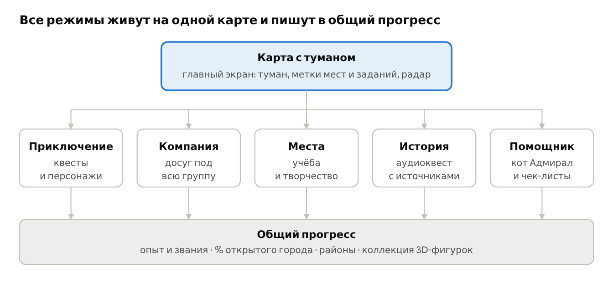

# Туман Владивостока · Вайбатон

**Город под туманом, который рассеивается, пока ты его осваиваешь.**

Приложение для досуга и знакомства с Владивостоком. Карта города закрыта туманом и открывается там, где ты побывал. Поверх карты пять режимов:

| Режим | Что делает |
| --- | --- |
| Приключение | квесты и персонажи на реальных местах города |
| Компания | подбирает, куда пойти группе с разными интересами, бюджетами и свободным временем |
| Места | бесплатные и недорогие места для учёбы и творчества |
| История | аудиоквест, у каждого факта есть источник |
| Помощник | первые шаги для первокурсников, новых жителей и туристов |



## Документы

- [Диз-док](docs/design-doc.md): концепция, экраны, режимы, визуальный стиль, сценарий демо, стек, задачи, интеграции
- [Бриф по графике и 3D](docs/brief-max.md): список ассетов, форматы, имена файлов, куда класть
- [Движок карты](docs/map-engine.md): рельеф, туман, маршруты с высотами и как подключить его в React Native через WebView

## Основа

Проект вырос из уличной игры [«Туман Владивостока»](https://github.com/Limmmp/vl-fog): карта с туманом войны по GPS, квестовый движок, районы, PWA.

## Статус

Идёт хакатон. Есть прототип движка карты (`src/engine`), он опубликован на https://limmmp.github.io/vibeoton-tuman/. Локальный запуск:

```bash
npm install
npm run dev
```

Открыть http://localhost:5173. Приложение на React Native + Expo появится здесь же.
