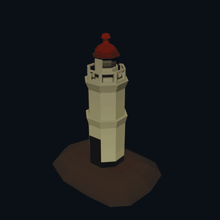
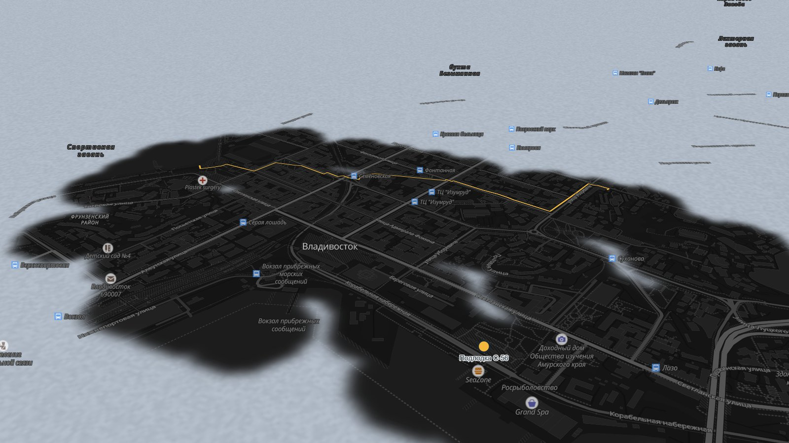
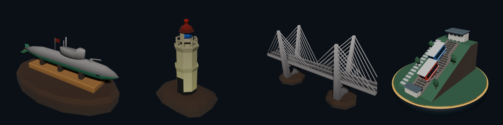

<div align="center">



# Туман Владивостока

**Город проясняется, когда ты в нём живёшь**

Приложение для досуга и знакомства с Владивостоком. Карта города закрыта туманом
и открывается там, где ты побывал.

[Карта онлайн](https://limmmp.github.io/vibeoton-tuman/) · [Диз-док](docs/design-doc.md) · [Мобильное приложение](mobile/README.md)


[](https://github.com/Limmmp/vibeoton-tuman/actions/workflows/check.yml)

</div>



## Зачем

Каждый год во Владивосток приезжают тысячи студентов, новых жителей и туристов. Для них город — как улица в тумане. Мы превращаем знакомство с городом в игру: каждое полезное действие рассеивает туман. Сходил в новое место, нашёл, где позаниматься, выбрался с друзьями — и на карте стало светлее.

| Боль | Кто страдает | Что даёт приложение |
| --- | --- | --- |
| «Куда пойдём?» — у всех разные интересы, деньги и время | Компании друзей, одногруппники | «Компания»: подбор места под всю группу |
| Негде позаниматься бесплатно | Студенты, фрилансеры | «Места»: учёба и досуг бесплатно или недорого |
| Город чужой и стоит на сопках | Первокурсники, новые жители | Маршруты с подъёмом и профилем высот |
| Живёшь годами, а знаешь три улицы | Местные, туристы | Туман, районы, квесты и коллекция тянут в новые места |

## Что внутри

| Раздел | Что делает |
| --- | --- |
| 🧭 **Карта** | 3D-карта с рельефом и туманом, квесты «Золотой туман» с Дядей Гошей, районы с вехами 25 / 50 / 75 / 90 % |
| 👥 **Компания** | подбор места для группы: бюджеты, свободное время, погода, подъёмы. Объясняет, почему место подходит, дальше голосование и маршрут |
| 📍 **Места** | 198 мест из OpenStreetMap: учёба, досуг, фильтр по подъёму, пешие маршруты |
| 🎧 **История** | аудиомаршрут, у каждого факта есть источник (в работе) |
| ⭐ **Коллекция** | 3D-фигурки символов города за прогулки |

<div align="center">

<br><sub>Коллекция: подлодка С-56 · маяк Токаревского · Золотой мост · фуникулёр</sub>
</div>

**Под Владивосток:**
- каждый маршрут строится с профилем высот. Например, от Спортивной гавани до «Орлиного гнезда» — 1,6 км и подъём 111 м;
- высоты на мостах поправлены;
- клетка тумана — 20 м. Опыт даётся только за новую клетку, награды квестов в симуляции не выдаются.

## Быстрый старт

Нужен Node.js 24 (зафиксирован в `.nvmrc`).

**Карта** — стенд движка с отладочной панелью на http://localhost:5173:

```bash
npm ci --include=dev
npm run dev
```

**Мобильное приложение** (Expo Go на телефоне). Запускать строго из `mobile/`, не из корня:

```bash
cd mobile
npm ci
npx expo start -c
```

**Проверки** (те же гоняет CI):

```bash
npm run typecheck
npm test
npm run build
npm run data:check
```

<details>
<summary>Если что-то не ставится</summary>

- `npm ci` без `--include=dev` не подходит: TypeScript, Vite и `@types/node` нужны для сборки и лежат в devDependencies.
- `EPERM` для `esbuild.exe` на Windows — остановите запущенный Vite и повторите установку.
- Красный экран Expo «Unable to resolve module ../../App» — Metro запущен из корня репозитория. Остановите его и запустите из `mobile/`.

</details>

## Как устроено

```text
┌──────────────────────┐   postMessage   ┌──────────────────────────┐
│  Приложение          │ ◀────────────▶ │  Карта в WebView         │
│  React Native + Expo │                 │  MapLibre GL 5 + Vite    │
│  GPS, вкладки, UI    │                 │  рельеф, туман, 3D-дома  │
└──────────────────────┘                 └────────────┬─────────────┘
                                                      ▼
                                          OSM · Terrarium · OSRM
                                          места · высоты · маршруты
```

Карта — отдельная веб-страница, потому что нативный MapLibre не умеет 3D-рельеф, а для города на сопках он нужен. Протокол «приложение ↔ карта» описан в [src/engine/protocol.ts](src/engine/protocol.ts).

| Путь | Что |
| --- | --- |
| `src/engine/` | движок карты: подложка, рельеф, туман, игрок, маршруты с высотами, мосты, мост для WebView |
| `src/match/` | `matchGroup` — подбор места для группы по бюджету, времени, погоде и подъёмам |
| `src/progress/`, `src/quests/` | опыт, районы, награды, квесты |
| `mobile/` | приложение React Native + Expo |
| `data/` | каталог мест, факты, районы; ручные правки — в `data/manual/overrides.json` |
| `scripts/` | сбор мест из OSM, сборка и аудит данных |

## Документы

| | |
| --- | --- |
| [Диз-док](docs/design-doc.md) | концепция, экраны, режимы, стиль, сценарий демо |
| [Движок карты](docs/map-engine.md) | рельеф, туман, маршруты, подключение через WebView |
| [Подбор для компании](docs/match-group.md) | как `matchGroup` фильтрует и оценивает места |
| [Каталог мест](data/README.md) | формат `places.json`, источники, ручные правки |
| [Каким видим фронт](docs/frontend-vision.md) · [Визуал карты](docs/map-visuals.md) | стиль, токены, анимации, 3D |
| [Фичи](docs/features.md) · [Экраны](docs/screens.md) | список фич и планировка экранов |
| [Бриф по графике и 3D](docs/brief-max.md) | ассеты, форматы, куда класть |
| [План работ](docs/work-plan.md) · [Аудит](docs/audit-2026-11-13.md) | что осталось и что проверить |

## Правила данных

- Факты и данные не выдумываем. У каждого места и факта есть `source`, допущения пишутся в `notes`.
- `verified: true` ставит только человек.
- Места правятся только в `data/manual/overrides.json`, потом `npm run data:build`.
- Ключи (GPTunnel и другие) — только в `.env`, репозиторий публичный.

## Команда Accept All Cookies

| | |
| --- | --- |
| **Денис Кустов** · [@Limmmp](https://github.com/Limmmp) | движок карты, данные, алгоритмы |
| **Дима Бондарчук** · [@Dimon1707](https://github.com/Dimon1707) | мобильное приложение |
| **Максим Пинчук** · [@Plumbam](https://github.com/Plumbam) | графика и 3D |

Проект вырос из уличной игры [«Туман Владивостока»](https://github.com/Limmmp/vl-fog): карта с туманом войны по GPS, квесты, районы.

<sub>Карта: OpenFreeMap · © участники OpenStreetMap · Mapzen/Terrarium. Маршруты: OSRM. Погода: Open-Meteo.</sub>
