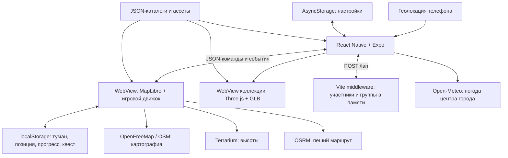
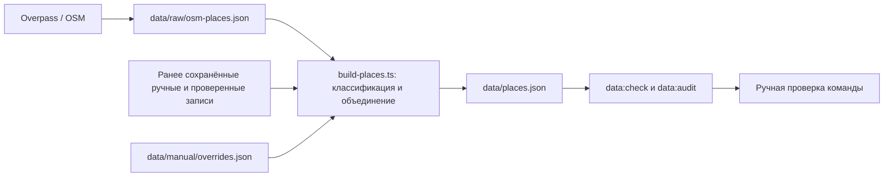

# «Туман Владивостока»: архитектура, стек, данные и кибербезопасность

Дата: 14 ноября 2026 года. Основа описания — текущие файлы рабочей копии проекта. На момент подготовки HEAD — `40fe957` (`pre-prod-version`); в рабочей копии есть последующие изменения. Документ не описывает автоматически содержимое опубликованной карты или других веток.

## 1. Назначение и границы системы

«Туман Владивостока» — мобильное приложение для исследования города. Пользователь перемещается по карте, открывает туман, получает опыт, проходит задания и рассматривает коллекционные 3D-модели. В локальной сетевой сессии можно видеть других участников и объединяться в группы.

Текущие пользовательские разделы: «Задание», «Компания», «Места», «Награды», «Профиль». В каталоге два задания: «Возвращение на Миллионку» и «Две фигурки города» с посещением С-56 и фуникулёра. В Миллионке нет таймеров и ожидания разговора. Каждая новая открытая ячейка даёт 1 XP, включая симуляцию. Уважение исключено из модели прогресса и наград.

Принципиальное ограничение: это прототип с локальным игровым состоянием и отдельным сервером демонстрационной LAN-сессии. В текущей рабочей копии нет серверной регистрации, пользовательской базы данных, OAuth, централизованной проверки достижений, облачного сохранения или платёжной системы. Помощник и работающий ИИ-прокси также не входят в текущую реализацию. Наличие таких идей в ранних документах не означает, что они реализованы.

В этом документе:

- **Реализовано** — поведение подтверждается просмотренными файлами.
- **Ограничение или риск** — вывод из реализации и её границ доверия.
- **Рекомендация** — предлагаемое изменение; оно не считается уже внедрённой защитой.

Это архитектурный разбор и исходная модель угроз, а не заключение о прохождении пентеста или сертификации.

Дополнение после восстановления встреч LAN: реализованы анкеты участников (бюджет, свободное время, желаемое место и интересы), общий подбор, три режима бюджета, выбор организатором места и точного времени. Публичный ID отделён от секретного токена; добавлены лимиты 64 клиента и 16 участников группы. Соответствующие пункты первоначального разбора ниже описывают исходный срез до этих изменений. Остальные ограничения LAN, включая открытые позиции и отсутствие TLS в локальном HTTP-режиме, сохраняются. Актуальный сценарий — [LAN-сессия](lan-session.md).

## 2. Общая архитектура

Система разделена на нативный интерфейс, веб-движок карты, статические наборы данных и небольшой сервер присутствия.

### 2.1. Мобильная оболочка

Входная точка пользовательского интерфейса — [mobile/App.tsx](../mobile/App.tsx). Она координирует навигацию, GPS, подключение карты, квестовые события, сообщения об ошибках и отображение прогресса. Общие компоненты и оформление находятся в `mobile/src/ui.tsx`, жесты и переходы — в `mobile/src/motion.tsx`.

`MapSurface` сохраняет отдельный экземпляр WebView карты. Изменения интерфейса не должны каждый раз пересоздавать карту: иначе теряются графический контекст, загруженные тайлы и текущий сеанс. Полноэкранная коллекция использует собственный `CollectionPanel`. При открытии «Наград» верхние элементы карты скрываются, а её эффекты приостанавливаются.

Нативный интерфейс отвечает за разрешения устройства и пользовательское представление. Он не является защищённым сервером и не может доказать подлинность GPS или заработанного опыта.

### 2.2. Веб-движок

[src/main.ts](../src/main.ts) создаёт `Engine`, подключает мост и элементы управления. [src/engine/engine.ts](../src/engine/engine.ts) связывает подсистемы:

| Подсистема | Файлы | Ответственность |
| --- | --- | --- |
| Подложка и внешний вид | `basemap.ts`, `dark-style.ts`, `basemap-fallback.ts` | Векторная карта, чёрно-серая тема, резервная подложка |
| Позиция и аватар | `player.ts`, `simulation.ts` | GPS, симуляция, направление, статичный аватар и GIF движения |
| Туман | `fog.ts`, `fog-index.ts` | Открытые ячейки и непрозрачный светло-серый слой |
| Объёмные здания | `buildings.ts`, `building-index.ts` | Выборка и отрисовка домов в открытых областях |
| Высоты и маршруты | `dem.ts`, `bridges.ts`, `route.ts`, `route-arrival.ts` | Высотный профиль, поправка мостов, маршрут и завершение при прибытии |
| Задания | `src/quests/` | Каталог, схема, последовательность шагов, восстановление состояния |
| Прогресс | `src/progress/` | XP, уровень, награды, районы, инвентарь и журнал выдач |
| Модели | `src/models/`, `src/collection/` | Загрузка GLB, размещение на карте, отдельный просмотр |

Большая часть игровой логики отделена от React-компонентов. Это позволяет проверять расчёты и переходы состояний без телефона и графического рендеринга.

### 2.3. Граница между оболочкой и картой

[src/engine/protocol.ts](../src/engine/protocol.ts) задаёт TypeScript-контракты команд и событий. Оболочка отправляет JSON-команду с `id`, движок отвечает `result` с тем же `id`. События вроде `playerMoved`, `activeStep`, `progressChanged` и `routeCleared` сообщают об изменениях независимо от запросов.

`mobile/src/bridge.ts` хранит очередь до `ready`, сопоставляет ответы с запросами, ограничивает число ожидающих запросов до 100 и использует тайм-аут 45 секунд. Отключение моста отклоняет незавершённые запросы. Это защита от зависаний интерфейса, а не механизм аутентификации.

На стороне веб-движка `src/engine/bridge.ts` разбирает сообщения, проверяет их источник и выполняет команды. Мост к родительскому iframe разрешён только в режиме разработки и для того же origin. В production ветка iframe-моста отключается. Нативный WebView остаётся отдельной доверенной границей: содержимое открытой в нём страницы получает возможность обмениваться сообщениями с приложением.

### 2.4. Локальная сетевая сессия

[scripts/lan-plugin.ts](../scripts/lan-plugin.ts) подключает `POST /lan` к серверу разработки Vite. Это не самостоятельный production API. GitHub Pages публикует статические файлы и не запускает этот middleware.

Пользователь явно включает соединение во вкладке «Компания». Клиент передаёт имя, позицию, токен и необязательное действие: создать группу, вступить по коду или выйти. После цикла обмена следующий запрос планируется через две секунды; фактический интервал дополнительно зависит от сетевой задержки и выполнения команд моста. Сетевой запрос прерывается через пять секунд.

Сервер хранит участников в `Map` в памяти процесса. Участники, не обновлявшиеся более 15 секунд, удаляются при обработке следующего запроса. Перезапуск сервера удаляет всех участников и группы. Телефоны видят друг друга потому, что используют один сервер, а не потому, что приложение обнаруживает общий Wi-Fi или проверяет SSID. Любое устройство, имеющее доступ к этому серверу, потенциально может подключиться.

Группа сейчас меняет отношение игрока на `party` и его визуальное выделение. Она не создаёт отдельный приватный канал и не ограничивает получение чужих координат.

## 3. Почему выбран этот стек

Версии ниже взяты из `package.json`, а не являются рекомендацией установить последние версии. Точные зависимости фиксируют отдельные lockfile корня проекта и `mobile/`.

| Технология | Роль и обоснование | Компромисс |
| --- | --- | --- |
| React 19.3, React Native 0.88.1 | Общая компонентная модель мобильного UI, повторное использование TypeScript-кода | Нужны проверки на реальных Android/iOS, особенности платформ остаются |
| Expo SDK `~58.0.25` | Быстрый запуск прототипа, единые модули геолокации, ассетов, аудио и сборки | Совместимость SDK, Expo Go и нативных библиотек нужно проверять совместно |
| TypeScript | Общие типы мест, команд, заданий и прогресса; проверка связей при сборке | Типы не проверяют автоматически JSON, сеть и сохранения во время исполнения |
| MapLibre GL `^5.24.1` | Векторные слои, наклон, рельеф, источники данных и WebGL-отрисовка | Зависимость от GPU, WebView и доступности картографических сервисов |
| WebView | Одна реализация карты для приложения и браузерного стенда | Дополнительная граница безопасности и отдельное браузерное хранилище |
| Three.js `^0.187.0` | Загрузка glTF/GLB, просмотр и размещение собственных 3D-моделей | Размер, текстуры и геометрия могут перегрузить память телефона |
| Vite `^7.3.8` | Быстрая разработка карты и сборка отдельных HTML-точек входа | Dev-сервер не заменяет защищённый сервер приложения |
| Reanimated, Gesture Handler, Worklets | Анимации и жесты шторок, меньше работы на JS-потоке интерфейса | Требуется совместимая нативная среда; сборка JS не доказывает корректность всех жестов |
| React Native SVG | Единый масштабируемый набор иконок | Нужно поддерживать подписи доступности и единый стиль |
| AsyncStorage и localStorage | Простое локальное состояние без обязательной регистрации | Нет встроенной серверной синхронизации, доказательства подлинности или защиты секретов |
| Node.js 24 и `node:test` | Скрипты данных и тесты TypeScript без отдельного сервера БД | Версия Node фиксируется в `.nvmrc`; среда разработчика должна соответствовать |
| JSON + Git | Прозрачные изменения каталога и ассетов, удобное ревью на хакатоне | Обновление части данных требует пересборки; Git не подходит для хранения пользовательской геолокации |
| GitHub Actions + Pages | Воспроизводимая статическая публикация карты и коллекции | Независимые версии мобильного приложения и сайта могут разойтись |

Выбор WebView объясняется потребностью использовать существующий веб-движок с рельефом и собственными слоями. Утверждение, что любая нативная реализация принципиально не поддерживает нужные функции, не требуется: это архитектурный выбор текущего проекта, а не универсальное ограничение всех SDK.

Для прототипа отсутствие общей базы сокращает время разработки и эксплуатационную сложность. Для публичного сервиса с аккаунтами, приватными группами и ценными наградами этого подхода недостаточно.

## 4. Производительность и отказоустойчивость

`src/engine/performance.ts` задаёт профили `low`, `balanced`, `high`. Они ограничивают pixel ratio, размер холста тумана, частоту его обновления, количество зданий, рельеф и наклон. Пространственные индексы позволяют выбирать ближайшие открытые ячейки и здания, не обрабатывая каждый раз весь город.

Карта сохраняется между переходами интерфейса. Для скрытых экранов и ухода приложения в фон приостанавливаются эффекты. Это не равнозначно отключению GPS или сетевой передачи: разрешения, подписки и LAN-цикл нужно оценивать отдельно.

Если векторная подложка не загрузилась, используется растровая OSM. В этом сценарии сохраняются игровые слои. Неудачная загрузка GLB заменяется геометрической заглушкой. Ошибки хранилища перехватываются: приложение может продолжить работу, но сохранность изменений уже не гарантируется.

Эти меры повышают доступность, однако не обеспечивают полноценный офлайн-режим. Для новых тайлов, высот и маршрутов необходимы внешние сервисы.

## 5. Данные проекта и их жизненный цикл

### 5.1. Публичные справочные данные

По состоянию просмотренных файлов `data/places.json` содержит 198 мест, `data/districts.json` — 36 районов, manifest коллекции — четыре модели. Эти числа меняются вместе с файлами и не должны считаться постоянными параметрами системы.

Основной контракт места — [src/data/place.ts](../src/data/place.ts): идентификатор, название, `lat`/`lon`, категории, цена, часы, теги, источник, дата проверки, `verified`, примечания. `null` означает неизвестное значение, а не нулевую цену или отсутствие ограничения. Например, неизвестная стоимость не должна автоматически превращаться в «бесплатно».

Конвейер каталога:

Повторная сборка сохраняет проверенные и ручные записи; поверх результатов применяются overrides. Правки следует вносить в `data/manual/overrides.json`, а не непосредственно в сгенерированный каталог. `verified: true` ставит человек после проверки. Наличие `source` означает прослеживаемость происхождения, но само по себе не доказывает истинность информации.

Точность координат, доступность места, стоимость и расписание требуют отдельной проверки. Ошибка в данных может направить человека к закрытому или неудобному месту; это риск качества и физической безопасности, а не только проблема интерфейса.

### 5.2. Туман, опыт и задания

Туман — множество ключей `row:col` сетки 20 × 20 метров. Базовый радиус открытия вокруг игрока — 45 метров. Ключи участвуют в расчётах площади и районов, а также в журнале уникальных открытий.

`ProgressManager` хранит XP и журнал уже увиденных ячеек. Новая ячейка даёт 1 XP; повторный проход, перезапуск и сброс визуального тумана не должны превращать старые ячейки в новые награды. Симуляция теперь тоже даёт XP. Уровень рассчитывается по общим порогам из `src/progress/level.ts`.

Награды квестов и отдельных действий учитываются по ключам завершённых заданий и выдач. Это обеспечивает однократность внутри честного локального состояния. Пользователь, контролирующий хранилище или JS-контекст, может изменить состояние; криптографической защиты и серверного подтверждения здесь нет.

`QuestRunner` исполняет шаги задания и формирует активные цели. При загрузке сохранение сопоставляется с текущим каталогом: удалённый квест не восстанавливается, старое ожидание Миллионки не возвращается. История уже выданных наград может сохраняться отдельно от списка доступных заданий.

Важно: флаг `trusted` не является доказательством настоящей прогулки. В текущем движке запуск каталожного задания через `startQuestById` устанавливает доверенный контекст независимо от режима игрока. Проверка GPS в интерфейсе и доверие к каталогу не заменяют серверную проверку. Текст «в симуляции награда не выдаётся» нельзя считать полноценной гарантией защиты от обхода.

### 5.3. Локальное хранение

| Данные | Где находятся | Срок и ограничения |
| --- | --- | --- |
| Настройки, выбранный адрес карты, интересы, локальные параметры | AsyncStorage, `tuman.preferences.v1` | До изменения/удаления данных приложения; не защищённое хранилище секретов |
| Туман, последняя позиция, прогресс, активный квест, параметры карты | localStorage с префиксом `tuman:` | Привязаны к origin WebView; могут быть удалены, изменены или потеряны |
| Имя, актуальная позиция и группа LAN-участника | Память Node.js-процесса | До очистки неактивных записей или перезапуска |
| LAN-токен | React ref клиента и идентификатор серверной записи | Нет отдельной политики ротации; реализация небезопасна, см. раздел 8 |
| Каталог, manifest, GLB, SVG, GIF | Репозиторий и опубликованные статические файлы | Публичные ассеты; не место для секретов |

`load<T>` делает `JSON.parse` и приведение типа. Это не полная runtime-валидация. Повреждённые, чрезмерно большие или вручную изменённые сохранения нужно считать недоверенными.

Origin — сочетание протокола, хоста и порта. `https://limmmp.github.io`, `http://192.168.1.10:5173` и другой локальный IP имеют разные хранилища. Поэтому смена адреса карты может выглядеть как потеря прогресса. Сам откат Git также не восстанавливает AsyncStorage, localStorage и уже установленный `node_modules`.

Сброс тумана или наград не является гарантированным удалением всех персональных данных: отдельно остаются настройки, позиция, браузерные данные и временная серверная запись.

### 5.4. Пользовательские ассеты

Модели находятся в `public/models/landmarks/`, размещение описано в `manifest.json`. Статичный персонаж — `public/avatar/Sprite.svg`, анимация движения — `public/avatar/Schoolboy.gif`; соответствие задаёт `public/avatar/config.json`.

GLB нормализуется по размеру и проверяется на наличие видимой геометрии. Загрузка имеет тайм-аут 15 секунд и ограничение 20 МБ, но проверка размера происходит после получения `arrayBuffer`. Это не предотвращает выделение памяти для слишком большого ответа. Кроме того, glTF может ссылаться на внешние ресурсы: отдельный контроль текстур, URI и суммарной памяти необходим.

Туман скрывает картографию визуально, но не шифрует исходные данные. Наличие модели в публичном `public/` означает, что файл можно получить независимо от игрового достижения. Коллекция сейчас демонстрационная, а не защищённая система доступа к призам.

## 6. Внешние сервисы и передача данных

| Получатель | Что получает или может определить | Зачем используется |
| --- | --- | --- |
| GitHub Pages | Запросы сайта и ассетов, сетевые метаданные, включая IP | Хостинг карты и коллекции |
| OpenFreeMap | Стиль и запросы тайлов; по тайлам можно приблизительно определить просматриваемую область | Основная картография |
| OpenStreetMap tile server | Координаты тайлов и сетевые метаданные при резервной загрузке | Растровая подложка |
| AWS Terrarium | Запросы высотных тайлов соответствующей области | Рельеф и высоты |
| `routing.openstreetmap.de` | Начальная и конечная координаты маршрута в URL запроса | OSRM, пешая геометрия |
| Open-Meteo | В текущем коде фиксированные координаты центра Владивостока, а не точная позиция игрока | Погода |
| Overpass | Область и параметры выгрузки справочных объектов при запуске скрипта команды | Подготовка каталога |
| Настроенный LAN-сервер | Имя, точная текущая позиция, токен и действия группы | Присутствие и совместная карта |

HTTPS защищает передачу между клиентом и сервером, но не скрывает данные от самого получателя. Отсутствие собственной базы истории не означает отсутствия журналов у внешних провайдеров. Их фактические правила хранения в этом разборе не проверялись.

Следует отдельно учитывать внешние фотографии, сайты мест и аудио, если соответствующий контент используется: обращения могут раскрывать IP и контекст просмотра. Нельзя писать «координаты никуда не передаются»: маршрутизация и LAN-сессия используют их явно.

## 7. Модель угроз

### 7.1. Что необходимо защищать

Приоритетные активы: текущая и последняя позиция пользователя; выводы о его перемещениях; LAN-сессия и членство в группе; целостность прогресса; доверенное содержимое WebView; исходники, зависимости, учётные записи публикации и ключи подписи приложения.

Имена и координаты даже без регистрации могут связываться с конкретным человеком. Набор открытых ячеек также раскрывает посещённые области и не должен считаться безобидным только потому, что это игровые данные.

### 7.2. Возможные нарушители

- Участник той же сети или человек, получивший доступ к LAN-серверу.
- Владелец подставного адреса карты либо сервера, введённого в настройки.
- Злоумышленник, контролирующий устройство, localStorage, devtools или подменённую геопозицию.
- Автор вредоносной зависимости, ассета или изменения в репозитории.
- Нарушитель, получивший доступ к GitHub, CI, ключам подписи или компьютеру организатора.
- Случайная ошибка команды: публикация секрета, неверные права, запуск dev-сервера в публичной сети.

### 7.3. Основные границы доверия

1. ОС и геолокация — нативный интерфейс.
2. Интерфейс — содержимое WebView.
3. Локальные сохранения — игровая логика.
4. Телефон — LAN-сервер.
5. Клиент — сторонние картографические и маршрутные сервисы.
6. Источники OSM и ручные правки — опубликованный каталог.
7. Разработчик и зависимости — CI — опубликованный сайт/приложение.

## 8. Подтверждённые риски текущей реализации

Приоритеты ниже — инженерная оценка для проекта, а не рассчитанный CVSS.

| Приоритет | Наблюдение и основание | Возможное последствие | Необходимое изменение |
| --- | --- | --- | --- |
| P0 | В `/lan` публичный `client.id` совпадает с ключом, принимаемым как `data.token`; ID других игроков возвращаются участникам | Участник может выдавать себя за другую серверную запись, менять её позицию, имя и группу | Разделить публичный ID и секрет сессии; проверять полномочия на сервере |
| P0 | `/lan` возвращает координаты всех остальных записей без проверки приватности группы | Любой подключившийся видит точные позиции участников | Выдавать позиции только разрешённым получателям; добавить явное управление видимостью |
| P0 | Адрес карты допускает произвольные HTTP/HTTPS-хосты, WebView имеет JS и мост; прикладной allowlist навигации не задан | Подставная страница может получать передаваемую позицию и подделывать события | Разрешённые origin и пути, проверка навигации, независимая проверка входящих событий |
| P1 | Локальный HTTP, в Android включён `usesCleartextTraffic`, для iOS разрешена локальная сеть | При контроле канала возможны чтение и изменение трафика | Выделить dev-конфигурацию; для выпуска — HTTPS и минимальные сетевые исключения |
| P1 | Нет аккаунтов и разграничения доступа к LAN API | Знание адреса сервера фактически открывает участие в сессии | Аутентификация, приглашения, авторизация операций и проверка членства |
| P1 | Нет лимита участников, частоты запросов и общего объёма ответов | Истощение памяти и замедление телефона/сервера | Лимиты на клиента и сессию, rate limiting, ограничение выдачи |
| P1 | Прогресс и команды полностью контролируются клиентом; `trusted` не доказывает GPS | Подмена XP, наград, координат и завершений | Для ценных наград — серверное подтверждение и антифрод; текущие награды считать игровыми |
| P1 | Форматы сообщений моста проверяются частично; типы TS отсутствуют во время исполнения | Некорректные события могут нарушить работу UI или состояния | Runtime-схемы всех команд, событий и сохранений; лимиты размеров и частоты |
| P2 | Локальное хранение позиции и открытых ячеек без специального шифрования приложения | Раскрытие при доступе к устройству, JS-контексту или резервным копиям | Минимизация данных; защищённое хранение секретов; политика резервного копирования |
| P2 | Ограничение GLB применяется после загрузки; внешний контент ограничен неполностью | Перерасход памяти, зависание GPU, нежелательные сетевые обращения | Контроль потока загрузки, геометрии, текстур, внешних URI |
| P2 | CI проверки корня и публикация разделены; мобильные проверки не включены в просмотренный workflow | Публикация при непроверенной совместимости мобильного UI и карты | Общий обязательный gate и мобильная матрица проверок |

P0 — исправить до передачи сервиса недоверенным пользователям. P1 — до публичной эксплуатации. P2 — запланировать и проверить до устойчивого релиза.

### 8.1. Особенности LAN, которые легко принять за защиту

`randomUUID()` создаёт идентификатор, но его случайность не помогает, если этот же идентификатор публично раскрывается и затем принимается как секрет. Исправление должно менять серверную модель, а не только скрывать поле в интерфейсе.

Код группы — первые восемь шестнадцатеричных символов UUID, то есть пространство примерно 32 бита. Без ограничения попыток это не полноценный механизм авторизации. Кроме того, текущая группа вообще не скрывает позиции от остальных участников.

Проверка координат на конечность и диапазон, имя до 40 символов и ограничение тела около 4096 символов полезны. Однако размер измеряется длиной JavaScript-строки, а не строгим числом принятых байтов. Нет отдельного ограничения времени чтения запроса и суммарной нагрузки.

Истечение 15 секунд — логика очистки при следующем запросе. Она не равнозначна гарантированному немедленному удалению после кнопки «Отключиться». Даже истёкшая запись может оставаться в памяти до следующего обращения или остановки процесса.

### 8.2. WebView и XSS

Веб-контент нужно считать исполняемым кодом, а не картинкой внутри приложения. Подмена размещённой карты, XSS или переход на чужой origin могут пересечь границу к нативному приложению через сообщения.

Рекомендуется разрешать только известный production origin и явно выбранные адреса разработки. Для каждого сообщения проверять схему, тип, допустимые поля, размеры массивов, диапазоны чисел и соответствие текущему сеансу. Ссылки на сторонние сайты открывать вне доверенной WebView. Ресурс коллекции тоже должен иметь ограниченную навигацию.

Для отображения названий предпочтительны `textContent` и обычный React-текст. Избегать необработанного HTML из каталога. В проекте есть безопасные примеры создания DOM через `textContent`, но полный аудит всех DOM-вставок в рамках документа не выполнялся.

В production следует рассмотреть CSP с конкретными источниками скриптов, подключений, изображений и worker. Политика должна учитывать MapLibre, WebGL и реальные ресурсы; без тестирования можно сломать карту. Также полезны ограничения встраивания и `Referrer-Policy`, если выбранный хостинг позволяет управлять нужными заголовками. Наличие таких настроек на опубликованном сайте не проверено.

Возможности настройки WebView описаны в [официальном руководстве react-native-webview](https://github.com/react-native-webview/react-native-webview/blob/master/docs/Guide.md). Применять их нужно с проверкой поведения на обеих платформах.

### 8.3. Подмена местоположения и игровая экономика

Фильтрация неточного GPS уменьшает ошибки, но не доказывает подлинность координат. Внешний фикс с заявленной точностью хуже 60 метров игнорируется. Нарушитель, контролирующий клиент, может изменить и позицию, и показатель точности.

Телепорт, симуляция, `window.tuman.exec`, сброс прогресса и локальные журналы удобны для разработки. Они делают клиент непригодным в роли единственного арбитра денежных или соревновательных наград. Скрыть кнопки разработчика недостаточно: сами команды и состояние всё равно остаются на клиенте.

Если появятся призы с реальной стоимостью, нужны серверный журнал выдач, идемпотентность, проверка последовательности событий, ограничение скорости перемещения и ручной разбор подозрительных случаев. Эти проверки тоже не гарантируют абсолютную защиту от поддельного GPS; уровень доверия должен быть явно описан.

## 9. Что уже помогает защите

В текущем коде присутствуют полезные, но ограниченные меры:

- Разрешение геолокации запрашивается у ОС. В `App.tsx` используется foreground-подписка; отдельная служба фонового GPS не реализована.
- Для `mapUrl` допустимы только схемы HTTP и HTTPS. Это отсекает другие схемы, но не вредоносный HTTP/HTTPS-сайт.
- Веб-мост ограничивает источник отладочного iframe; production не использует эту ветку.
- Нативный мост имеет очередь, корреляцию, тайм-аут и ограничение ожидающих запросов.
- Сервер LAN проверяет диапазоны координат и ограничивает часть входных данных.
- Награды имеют локальную защиту от повторной выдачи; сохранения удалённых квестов адаптируются.
- Ошибки сети, модели и localStorage обрабатываются без обязательного завершения всего приложения.
- В `mobile/app.json` отключена запись микрофона для аудиомодуля; для квестового аудио запись не нужна.
- `.env` и его варианты исключены из Git по текущему `.gitignore`, а пример конфигурации хранится отдельно.
- Тесты покрывают игровой прогресс, переходы заданий, LAN-сценарии и жизненный цикл маршрута.

Ни один пункт не следует расширять до утверждения «проект полностью безопасен». В частности, `.gitignore` не удаляет уже опубликованный секрет из истории и не подтверждает отсутствие секретов в репозитории.

## 10. Секреты, зависимости и CI/CD

### 10.1. Секреты

Если позднее появятся GPTunnel, OAuth, серверные API или платные сервисы, их секретные ключи должны находиться на серверной стороне либо в предназначенном для этого хранилище CI. Значения `EXPO_PUBLIC_*` предназначены для клиентского кода и не подходят для секретов. Помещение ключа в клиентский `.env` не делает его недоступным после сборки.

Для постоянных клиентских токенов требуется защищённое платформенное хранилище. AsyncStorage и localStorage нельзя считать заменой Keychain/Keystore. Само приложение всё равно должно иметь ограниченные полномочия и возможность отзыва сессии.

При утечке ключ сначала отзывают и заменяют. Одного удаления строки из последнего коммита недостаточно. Нужно проверить историю, сборочные артефакты, журналы и круг лиц с доступом.

### 10.2. Зависимости

Lockfile и `npm ci` помогают воспроизводить установку; это не проверка безопасности каждого пакета. Поведение clean install описано в [документации npm ci](https://docs.npmjs.com/cli/v11/commands/npm-ci/).

Практика для проекта: ревью изменений lockfile, регулярная проверка advisories, анализ прямых и транзитивных пакетов, проверка install-скриптов и лицензий. Обновления React Native, Expo, Reanimated и Worklets проверять как совместимый набор. Обновления MapLibre и Three.js проверять на GPU, памяти и WebView.

В рамках подготовки документа не выполнялись `npm audit`, сканирование секретов и сопоставление зависимостей с CVE. Поэтому документ не утверждает отсутствие уязвимых версий.

### 10.3. Публикация

`check.yml` проверяет чистую установку корня, TypeScript, тесты, сборку и данные. В просмотренном файле нет отдельной job для `mobile/`. `pages.yml` собирает и публикует `dist` при push в `main`; отдельный workflow проверки не становится автоматически обязательной зависимостью публикации.

Рекомендуется защитить основную ветку, требовать ревью и успешные checks, включить MFA владельцев, сократить права токенов, ограничить deployment environment и закреплять сторонние Actions по проверенному commit SHA. Секреты не должны попадать в вывод команд и артефакты.

Нужны идентификатор версии протокола/сборки, проверка совместимости клиента и карты и понятный откат обоих компонентов. Откат сайта не восстанавливает автоматически клиентские сохранения. Перед миграцией состояния нужно предусмотреть совместимость и резервирование, а не стирать пользовательские данные молча.

Dev-сервер Vite и Metro должны работать только в предназначенной для разработки сети. `host: true` или `0.0.0.0` открывает прослушивание всех доступных интерфейсов; фактическая достижимость зависит от сети и firewall. Настройки и предупреждения приведены в [документации Vite](https://vite.dev/config/server-options). Не следует заменять устранение сетевой ошибки отключением firewall, неограниченным CORS или `allowedHosts: true`.

## 11. Конфиденциальность и управление данными

Перед подключением LAN пользователю нужно ясно сообщать, кто увидит его позицию и когда прекратится передача. Для публичной версии необходимы отдельные режимы: скрыт, виден своей группе, публичен. Настройка должна применяться на сервере, а не только скрывать маркер на одном телефоне.

Следует передавать минимально нужную точность, ограничивать частоту, не записывать полную историю перемещений без необходимости. Диагностические логи не должны содержать токены, точные координаты и полные URL маршрутов. Технические метрики можно собирать в агрегированном виде.

Нужны отдельные действия: отключить передачу позиции, удалить локальные данные, завершить/отозвать сессию. Для удаления следует перечислить все хранилища: AsyncStorage, WebView, серверная память, резервные копии и журналы. Нельзя обещать удаление у стороннего провайдера, если механизм этого не реализован.

До публичного запуска команда должна определить оператора данных, аудиторию, страны пользователей, сроки хранения, основания обработки, работу с несовершеннолетними и перечень внешних получателей. Правовые требования зависят от фактической модели сервиса; здесь не проводится юридическая экспертиза и не утверждается соответствие конкретному закону.

## 12. Проверки перед публичной эксплуатацией

Рекомендуемый порядок работ:

1. Исправить совпадение публичного ID и секрета LAN-сессии. Проверить, что участник A не может изменять запись B.
2. Реализовать серверное разграничение видимости. Проверить, что пользователь вне группы не получает её координаты даже через прямой API-запрос.
3. Ограничить origin карты, коллекции и переходов WebView. Проверить отклонение постороннего сайта и поддельных событий.
4. Отделить локальный dev-режим от выпускной конфигурации, внедрить HTTPS для публичного API.
5. Ввести ограничения размера, числа участников, частоты, длительности запроса и объёма ответа.
6. Добавить runtime-валидацию команд, событий, сетевых ответов и сохранений; проверить неизвестные поля, большие массивы, `NaN`, некорректные координаты и повреждённый JSON.
7. Проверить отказ/отзыв GPS, отключение LAN, уход в фон, смену адреса сервера и потерю сети на реальных устройствах.
8. Проверить старые сохранения, повторную выдачу наград, симуляцию и параллельные запросы; отдельно описать предел антифрода.
9. Выполнить dependency/secret scanning, проверить права CI и репозитория, испытать откат публикации.
10. Проверить фотографии, ссылки, аудио и GLB на нежелательные внешние обращения и чрезмерное потребление ресурсов.

Для систематизации мобильных проверок можно использовать категории хранения, криптографии, аутентификации, сети, платформы, кода, устойчивости и приватности из [OWASP MASVS](https://mas.owasp.org/MASVS/). Это ориентир для программы проверки, а не заявленное соответствие проекта стандарту.

Функциональные unit-тесты подтверждают отдельные сценарии. Они не заменяют тестирование авторизации, транспорта, WebView, зависимостей и инфраструктуры.

## 13. Реагирование на инциденты

| Ситуация | Первоочередные действия |
| --- | --- |
| Неожиданно видны чужие позиции | Остановить сетевую функцию, ограничить доступ к серверу, определить круг получателей, исправить авторизацию |
| Утёк токен или ключ | Отозвать, заменить, проверить журналы и историю; не ограничиваться удалением файла |
| Подменена опубликованная карта | Остановить выдачу GPS недоверенной странице, откатить доверенную сборку, проверить GitHub и CI, сменить скомпрометированные доступы |
| Повреждён каталог или ассет | Откатить конкретную версию, сохранить образец для анализа, проверить источник и сборку |
| Перегрузка LAN-сервера | Ограничить доступ и нагрузку, сохранить обезличенную диагностику, добавить лимиты до повторного запуска |

Порядок работы: ограничить ущерб, сохранить минимально необходимые доказательства, определить причину, устранить её, проверить исправление и сообщить затронутым сторонам по принятой политике. Логи инцидента сами могут содержать чувствительные данные и требуют ограниченного доступа.

## 14. Предлагаемая архитектура следующего этапа

Для публичного продукта мобильный клиент и карта могут остаться, но социальная функция должна перейти из Vite middleware в самостоятельный сервис:

- HTTPS API с аутентификацией и отдельным секретом сессии.
- Серверная модель пользователя, группы, приглашения и разрешений на координаты.
- Хранилище с ограниченным сроком жизни позиций; постоянная история только при обоснованной необходимости.
- Серверный журнал ценных наград и защищённые от повторной обработки операции.
- Наблюдаемость без раскрытия токенов и точной геолокации.
- Ограничения нагрузки, резервное копирование нужных данных и проверка восстановления.

SQL-база, кэш, WebSocket и reverse proxy могут быть выбраны после определения нагрузки и требований. Они не являются текущими компонентами проекта. Само добавление базы или WebSocket не решит отсутствие авторизации.

## 15. Краткая формулировка для представления проекта

Проект использует нативный интерфейс React Native и Expo, а картографический и игровой движок работает в WebView на MapLibre GL и TypeScript. Three.js отвечает за собственные коллекционные модели. Статические данные проходят сборку из OSM с сохранением ручных правок и происхождения записей. Прогресс хранится локально, совместная карта использует отдельную демонстрационную LAN-сессию.

Архитектура ускоряет разработку и повторное использование кода, но пока не обеспечивает защищённую многопользовательскую эксплуатацию. Главные задачи безопасности — разделить публичные ID и секреты, ввести авторизацию доступа к позициям, ограничить WebView доверенными источниками и отделить dev-среду от публичного сервиса.
