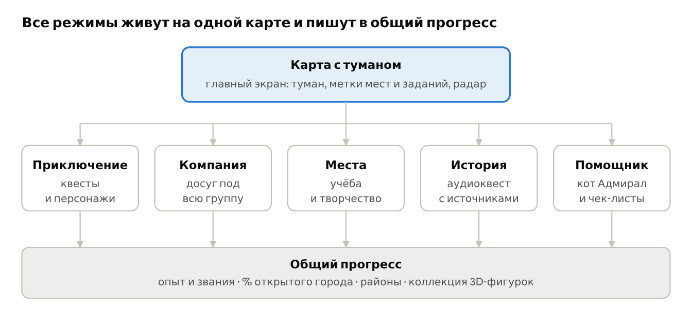

# Туман Владивостока — диз-док

Черновик для обсуждения · 13 ноября 2026

## 1. Концепция

**Владивосток под туманом, который рассеивается, пока ты осваиваешь город.** Это mobile-first приложение React Native + Expo для досуга и знакомства с городом. Интерактивная карта работает на MapLibre в WebView, потому что нативный MapLibre не поддерживает нужный 3D-рельеф. Основа — готовая игра «Туман Владивостока»: реальная карта закрыта туманом и открывается там, где ты прошёл ногами.

**Метафора.** Владивосток знаменит туманами, а новичку город так же непонятен, как улица в тумане. Каждое полезное действие — сходить в новое место, найти, где позаниматься, выбраться с друзьями, послушать историю квартала — рассеивает туман на карте. Пользу и игру не нужно склеивать: это одно и то же действие.

**Слоган (черновик):** «Город проясняется, когда ты в нём живёшь».

### Какие боли решаем

| Боль | Кто страдает | Ответ приложения |
| --- | --- | --- |
| «Куда пойдём?» — у всех разные интересы, деньги и время | Компании друзей, одногруппники | Режим «Компания»: подбор под всю группу |
| Негде позаниматься бесплатно, дома не работается | Студенты, фрилансеры, творческие люди | Режим «Места»: каталог с фильтром «бесплатно / недорого» |
| Город чужой, непонятно, с чего начать | Первокурсники, новые жители | Режим «Помощник»: первая неделя в виде квестов |
| Экскурсии дорогие или скучные, а в интернете полно мифов | Туристы и местные | Режим «История»: аудиоквест, у каждого факта есть источник |
| Живёшь годами, а знаешь три улицы; в туман и дождь нечем заняться | Все | Туман, районы, коллекция и квесты тянут в новые места |

### Персоны

- **Аня, 18 лет, первокурсница.** Приехала из другого города, живёт в общежитии. Денег мало, друзей пока нет. Нужно: понять город, найти где заниматься, влиться в компанию.
- **Игорь, 29 лет, переехал по работе.** Вечера и выходные свободны, но он не знает, куда идти. Нужно: районы, места «для своих», события.
- **Ли и Мин, туристы на 3 дня.** Хотят увидеть город по-настоящему, а не только набережную. Нужно: маршрут на полдня и истории без вранья.
- **Компания из 4 друзей.** У одного 300 ₽, у другого 2 000 ₽. Один любит настолки, другой хочет к морю. Нужно: быстро договориться.

### Чем мы отличаемся

Карты и справочники показывают **всё**. Афиши показывают **события**. Мы показываем **то, где ты ещё не был**, подбираем под **конкретную компанию** и превращаем знакомство с городом в игру с наглядным прогрессом.

## 2. Структура приложения

### Платформы

**Мобильное приложение — основной и полный продукт.** Только мобильный клиент рассчитан на GPS-прогулки, открытие тумана, геотриггеры, аудиоквесты, совместные маршруты и live-позиции группы. Основной интерфейс делает React Native + Expo; карта открывается внутри него через WebView.

**Desktop web — урезанный кабинет.** Он нужен для просмотра прогресса, коллекции и достижений, управления профилем, инвентарём и экипировкой, открытия магазина, друзей и планирования встреч. Desktop не считается целевой платформой для прохождения геоквестов и фонового GPS.

Опубликованная MapLibre-страница — движок для мобильного WebView и стенд разработки. Отладочная панель в браузере не является пользовательским desktop-интерфейсом.

Приложение — это одна карта с пятью режимами поверх, а не пять отдельных разделов. Любое действие в любом режиме рассеивает туман и идёт в общий прогресс.



Карта — общая основа: каждый режим показывает на ней свои метки. Прогресс замыкает петлю: чем больше открыт город, тем больше новых меток и заданий появляется на краю тумана.

## 3. Онбординг и главный экран

Первый запуск занимает не больше 30 секунд и трёх экранов. После него человек сразу попадает на карту с туманом и первым заданием.

### Онбординг

1. **Заставка.** Тёмный экран, по нему плывёт туман, сквозь него проступает силуэт Золотого моста. Логотип и слоган. Кнопка «Войти в туман».
2. **«Кто ты?»** Четыре крупные карточки с иллюстрациями: Первокурсник · Новый житель · Турист · Местный. Выбор определяет стартовый набор квестов и порядок режимов.
3. **Интересы.** Облако тегов, можно пропустить: море, смотровые, история, кофе, настолки, кино, спорт, музыка, искусство, учёба. Эти же теги потом подставляются в анкету «Компании».
4. **Разрешение на геопозицию** с понятным объяснением: «Туман рассеивается там, где ты идёшь. Данные остаются в телефоне». Отказ — не тупик: включается режим прогулки по карте пальцем.
5. **Первая реплика маскота.** Кот Адмирал выглядывает из-за края экрана: «Туман нынче густой. Пойдём, покажу, где тут что». На карте загорается первая жёлтая метка.

### Главный экран — карта

Карта занимает весь экран, интерфейс лежит поверх неё тонкими плашками. Сверху вниз:

| Зона | Что там |
| --- | --- |
| Верхняя плашка | Уровень и полоска опыта · «Открыто 0,42 км²» · погода («туман, +8°») |
| Карта | Тёмная подложка, поверх туман. Игрок — светящаяся стрелка. Метки мест и заданий видны и в тумане, но размытыми силуэтами |
| Правый край | Кнопки «Слои» (фильтр меток), «2D / 3D» и «Где я» |
| Левый нижний угол | Радар (уже есть) |
| Нижняя шторка | Контекст режима: активное задание, карточка места или результат подбора. Тянется вверх до полного экрана |
| Нижняя навигация | 5 вкладок: Карта · Компания · Места · История · Профиль |

**Помощник не вынесен во вкладку.** Это кот Адмирал, который живёт в углу карты и открывает чат и чек-лист по нажатию. Так он доступен из любого режима.

**Слои карты** (переключатели): Задания · Учёба и творчество · Досуг · История · События сегодня. В тумане метка показывает только тип места, а название скрыто за «???», пока ты там не побывал. Карточку при этом можно открыть: интрига не должна мешать пользе.

### Рельеф и 3D

**Владивосток — город на сопках, и карта это показывает.** Рельеф строится по карте высот, склоны оттенены, дома выдавлены в объём по их реальной высоте. Наклон камеры двумя пальцами превращает карту в макет города, а туман войны лежит прямо на склонах и обтекает сопки.

- **2D по умолчанию на слабых телефонах**, 3D включается кнопкой. В 2D рельеф остаётся отмывкой склонов, без наклона камеры.
- **Атмосферный туман у горизонта** — средствами самого движка карты: дальние кварталы растворяются в дымке. Это поддерживает метафору и не путается с туманом войны: тот плотнее и лежит на земле.
- **Высоты — это данные, а не только картинка.** Из той же карты высот считается набор высоты на маршруте. Его используют «Компания», «Места», маршруты и достижения (см. соответствующие разделы).
- **Подсказка про сопки** в карточке маршрута: «900 м, но +60 м в гору — около 15 минут». Для новичка это главная неожиданность города.

## 4. Режим «Приключение»

Режим почти целиком готов в «Тумане Владивостока». На хакатоне мы переносим его логику на новый движок карты с рельефом, даём ему лицо (портреты, иконки) и связываем с полезными режимами.

### Игровая петля

1. Выйти и идти: туман рассеивается в радиусе \~45 м.
2. Увидеть жёлтую метку — заказчика с заданием.
3. Взять задание, пройти шаги, получить опыт и монеты.
4. Задание уводит в незнакомый квартал, там открывается туман и появляются новые метки.

### Типы шагов заданий

| Тип | Суть | Статус |
| --- | --- | --- |
| `goto` | дойти до точки, можно на время | есть |
| `hold` | простоять N секунд в зоне | есть |
| `tail` | идти за NPC и не отставать | есть |
| `collect` | обойти несколько точек в любом порядке | есть |
| `explore` | открыть N новых ячеек тумана | есть |
| `listen` | у точки запускается аудио, шаг засчитывается, когда дослушал | новое |
| `quiz` | вопрос с 3 вариантами ответа по услышанному или увиденному | новое |
| `look` | «найди на фасаде…», подтверждение кнопкой | новое |
| `visit` | побывать в месте из каталога (библиотека, антикафе) и отметиться | новое |

### Персонажи и их новая роль

Каждый персонаж теперь не только игровой заказчик, но и проводник в один из полезных режимов.

| Персонаж | Характер | Ведёт в режим |
| --- | --- | --- |
| Дядя Гоша | старый контрабандист с Миллионки, главная сюжетная арка | История: рассказчик аудиоквеста |
| Капитан Сомов | картограф-ворчун | Места: «найди тихое место», разведка |
| Сёма Хайп | блогер | Компания: события, фототочки, смотровые |
| Баба Вера и кот Адмирал | добрая соседка и вечно сбегающий кот | Помощник: Адмирал — маскот |
| Лиза «Волна» | велокурьер | задания на время |
| Нина из ларька | сплетница | местные лайфхаки в Помощнике |
| Артём Краб, Кэндзи | колорит порта и Зелёного угла | только игра |

### Районы

Город разбит на микрорайоны (Центр, Эгершельд, Первая Речка, Чуркин и другие). Процент района — это доля пройденных улиц. За 25, 50, 75 и 90 % дают награды. На хакатоне добавляем видимые границы районов и экран «Мои районы» с прогресс-барами.

### Безопасность (уже заложена в концепт)

- Точки не ставятся на проезжую часть, стройки и в частные дворы.
- Ночью нет заданий в парках.
- Таймеры ставятся на паузу при скорости выше 25 км/ч.
- Тон — ироничная уличная романтика, без насилия и без инструкций к нарушениям.

**Открытый вопрос:** тема «контрабандистов» для социального проекта на хакатоне — ок? Можно смягчить до «старый моряк и хранитель городских тайн».

## 5. Режим «Компания»

За 2 минуты компания из 2–8 человек получает 3 варианта, куда пойти, которые вписываются в бюджет и свободное время каждого. У каждого варианта есть объяснение, почему он подходит именно им.

### Экраны

1. **Старт.** Кнопка «Собрать компанию» и два способа: «Передать телефон по кругу» (MVP) или «Поделиться ссылкой / QR» (нужен бэкенд). Выбор когда: сегодня вечером / завтра / выходные / своя дата.
2. **Анкета участника** (один экран, \~30 секунд):
   - Имя и аватар-эмодзи
   - Интересы: чипы, до 5 штук, подставляются из профиля
   - Бюджет: ползунок 0 → 3 000+ ₽ с отметками «бесплатно / до 500 / до 1 500»
   - Свободное время: двухсторонний ползунок «с … до …»
   - Откуда едет: район из списка (не точка — ради приватности)
   - Настроение: «спокойно ↔ активно» и галочка «без крутых подъёмов»
3. **Сводка группы.** Аватарки всех, общее окно времени («все свободны 18:00–21:30»), бюджетный потолок («до 400 ₽ на человека»), облако общих интересов. Кнопка «Подобрать».
4. **Результат: 3 карточки.** В каждой: фото, название, цена на человека, время, район и строка «почему вам», например: «Маше — настолки, Пете — море, всем по карману». На карточке иконки погоды («в помещении — сегодня туман»). Варианты стараемся делать разными: один бесплатный, один событие, один «неожиданный».
5. **Голосование.** Каждый ставит 👍 / 👎, победитель подсвечивается.
6. **План.** Маршрут на карте, время сбора, кнопка «Поделиться в чат» (картинка-приглашение) и кнопка «Сделать квестом»: всем приходит задание `goto`, а в месте встречи каждому открывается туман и даётся бонус «Вместе».

### Алгоритм подбора

1. **Жёсткие фильтры** отсекают неподходящее:
   - цена ≤ минимального бюджета в группе;
   - место открыто (или событие идёт) в общее окно времени;
   - дорога от каждого (с учётом подъёмов) + само занятие помещаются в окно; если кто-то отметил «без крутых подъёмов», маршруты с большим набором высоты отсекаются (порог подберём, ориентир \~40 м);
   - плохая погода → только места с тегом `indoor`.
2. **Оценка** оставшихся: для каждого участника — совпадение тегов места с его интересами (0–1). Итог = **минимум по участникам × 0,6 + среднее × 0,4**. Минимум важен: никому не должно быть совсем скучно. Бонус за место под туманом (никто там не был).
3. **Разнообразие:** топ-3 берём из разных категорий.
4. **Объяснение:** LLM получает только уже выбранные места и анкеты и пишет одну строку «почему вам». ИИ не выбирает места сам, поэтому не придумает несуществующее. Без LLM строка собирается из шаблона по совпавшим тегам.
5. **Ничего не нашлось** → показываем, какое условие мешает: «если поднять бюджет до 600 ₽, появится 4 варианта».

### Данные

Места берём из общего каталога (раздел 12), события — из `events.json`. Для демо хватит 50–80 мест и 15–20 событий на даты защиты. **Открытый вопрос:** откуда брать события — проверить открытые афиши с API (например, Timepad) или собрать вручную.

## 6. Режим «Места»

Каталог бесплатных и недорогих мест для учёбы, работы и творчества. Главный вопрос, на который он отвечает: **«где мне прямо сейчас сесть с ноутбуком / гитарой / скетчбуком и не потратиться?»**

### Что в каталоге

| Категория | Примеры |
| --- | --- |
| Учёба и работа | библиотеки, читальные залы, коворкинги (в т.ч. вузовские), антикафе, кафе с розетками |
| Творчество | креативные пространства, репетиционные базы, мастерские, бесплатные кружки и студии |
| На улице | скверы с лавками, набережные, смотровые (для скетчей, фото, чтения) |
| Бесплатные события | лекции, дни открытых дверей, бесплатные дни в музеях |

### Экраны

1. **Список + карта.** Вверху быстрые фильтры-чипы: **Бесплатно · До 300 ₽ · Открыто сейчас · Wi-Fi · Розетки · Тихо · Можно шуметь · Рядом · Без подъёма**. Режим цели: «учиться / творить / встретиться» меняет набор фильтров. Переключатель «список / карта».
2. **Карточка места** (нижняя шторка): фото, название, цена («бесплатно» крупно и зелёным), часы и «открыто ещё 2 ч», дорога с профилем высот («8 мин, +35 м»), теги-иконки, мини-отзывы-теги («тихо» × 12, «быстрый Wi-Fi» × 7), источник и дата проверки. Кнопки: «Маршрут», «Я здесь» (чекин → награда и туман), «Сообщить об ошибке».
3. **Добавить место.** Форма: точка на карте, название, цена, теги, фото. Новое место получает пометку «не проверено», пока его не подтвердят 3 человека или модератор. Автору — бейдж «Картограф» от Капитана Сомова.

### Связь с игрой

- Чекин в месте из каталога рассеивает туман вокруг него и даёт опыт.
- Задания Капитана Сомова: «найди 3 бесплатных места для учёбы в районе», «проверь, есть ли розетки».
- Достижение «Сессия сдана»: 5 чекинов в местах для учёбы.

**Открытый вопрос:** заглянуть в соседний проект `vvgu-coworking` — возможно, там уже есть данные или контакты.

## 7. Режим «История»

Один отполированный аудиоквест на 45–60 минут по центру города. Это аудиоспектакль, а не экскурсия: рассказчик Дядя Гоша ведёт игрока по городу, а каждый исторический факт подкреплён источником.

### Маршрут «Золотой туман» (черновик, 6 точек)

Маршрут опирается на готовую сюжетную арку. Темы — что рассказываем; конкретные факты, даты и цифры ещё нужно собрать и проверить.

| # | Точка | Тема | Шаги | Иллюстрация |
| --- | --- | --- | --- | --- |
| 1 | Центральная площадь | как появился город, завязка сюжета | `listen` | — |
| 2 | Арбат (ул. Адмирала Фокина) | торговая и портовая жизнь старого города | `listen`, `look` | тогда / сейчас |
| 3 | Дворы Миллионки | китайский квартал, его легенды и реальность | `listen`, `quiz` | тогда / сейчас |
| 4 | Подлодка С-56 | флот и военная история города | `tail`, `listen` | 3D-фигурка |
| 5 | Фуникулёр | сопки, лестницы и транспорт города | `goto`, `listen` | 3D-фигурка |
| 6 | Орлиное гнездо | вид на Золотой Рог и мост, финал и крючок на маяк | `hold`, `quiz` | тогда / сейчас |

### Экран точки

- **Плеер** в нижней шторке: портрет рассказчика, волна звука, субтитры в формате «Имя: текст». Аудио запускается само в радиусе 30 м от точки (геотриггер).
- **Слайдер «тогда / сейчас»:** иллюстрация Макса или архивное фото (если лицензия позволяет) поверх современного вида.
- **Карточки фактов:** 2–3 коротких факта под плеером. У каждого кнопка **«Откуда это известно?»**, которая показывает источник (книга, музей, архив, ссылка). Значок «✓ проверено» или «легенда».
- **Легенда или факт?** Рассказчик может травить байки, но интерфейс всегда помечает их как легенды. Это и есть наша «достоверность»: мы не запрещаем истории, а честно отделяем их от фактов.

### Процесс работы с фактами

1. Агент собирает черновик фактов по каждой точке **со ссылками на источники**.
2. Человек открывает каждый источник и сверяет. Только после этого ставится `verified: true`. Факт без источника выкидываем или помечаем как легенду.
3. По проверенным фактам пишется сценарий реплик Дяди Гоши (по 60–90 секунд на точку).
4. Озвучка синтезом речи (ElevenLabs или Yandex SpeechKit), у каждого персонажа свой голос. Файлы лежат в статике, чтобы работать без интернета.
5. Пройти маршрут ногами хотя бы один раз до защиты и уточнить координаты точек.

**Дальше (вне MVP):** маршруты по Эгершельду и Токаревскому маяку, фортам крепости, Русскому острову; перевод на английский, китайский и корейский для туристов.

## 8. Режим «Помощник»

Кот Адмирал ведёт новичка по первой неделе в городе. Каждый пункт чек-листа — это квест с точкой на карте, а не статья, которую нужно читать. Плюс чат для вопросов, который отвечает только по проверенной базе.

### Чек-листы по типу пользователя

| Первокурсник | Новый житель | Турист |
| --- | --- | --- |
| Добраться от кампуса до центра | Разобраться с транспортом и оплатой | Маршрут «город за полдня» |
| Найти бесплатное место для учёбы | Найти свой район: магазины, аптеки, парки | Исторический аудиоквест |
| Увидеть море и главную смотровую | Сходить на одно городское событие | Попробовать местную еду |
| Собрать первую компанию через «Компанию» | Найти клуб или сообщество по интересам | Увидеть мосты и маяк |
| Узнать, где дешёво поесть | Открыть 3 района на 25 % | Купить сувенир у местных мастеров |

Конкретные пункты — черновик. Список дорабатываем по опыту самих студентов и новичков (спросить 5–10 знакомых — заодно цитаты для питча).

### Экраны

1. **Кот на карте.** Иконка Адмирала в углу с бейджем «3/10». Иногда он сам подаёт реплику-подсказку («Рядом библиотека, там розетки и тихо»).
2. **Чек-лист.** Пункты с иконками и кнопкой «Покажи на карте». Выполненные зачёркиваются с анимацией отпечатка лапы. За весь список — звание «Свой в тумане» и фигурка Адмирала.
3. **Чат «Спроси Адмирала».** Подсказки-кнопки: «Где позаниматься?», «Куда сходить в дождь?», «Как добраться до…?». Ответ приходит с карточками мест из каталога и ссылкой на источник.

### Правила чата

- Отвечает **только по нашей базе** (места, факты, события, шпаргалки). Нет в базе → «Не знаю. Лучше спросить в…».
- Не даёт медицинских, юридических и финансовых советов, а направляет к специалистам.
- Говорит в роли кота, но факты подаёт без искажений.
- **Чат отсекается первым**, если не хватает времени. Чек-лист и реплики-подсказки работают и без него.

## 8.5. Аватар и социальная карта

Персонаж игрока связывает квесты, прогресс и режим «Компания». Игрок собирает косметические предметы, вступает во временные группы и видит их участников на карте.

### Аватар

- Внешний вид состоит из тела, головы, верха, низа, аксессуара и рамки профиля.
- Одежда и аксессуары выдаются за квесты, районы, историю и совместные походы.
- Косметика не даёт игровых преимуществ.
- Для MVP используем PNG/SVG-слои. Low-poly 3D добавляем только после проверки производительности.
- React Native рисует редактор и профиль. Карта получает готовое представление аватара через WebView-протокол.

### Группы

Игрок создаёт группу, задаёт активность, время, район, бюджет и лимит участников. Вступление идёт по ссылке, QR или подтверждённой заявке. После выбора места группа получает общий маршрут и может получить мини-квест.

Точную точку встречи и позиции участников видят только принятые участники. До вступления показываются район, время, бюджет, интересы и число свободных мест.

### Приватность

Режимы видимости: `hidden`, `party`, `friends`, `public`.

- Точная позиция доступна только подтверждённой активной группе.
- Для друзей отдельно выбирается точная или приблизительная позиция.
- Публичный режим показывает зону 100–300 м, обновляется редко и не хранит маршрут.
- Геосессия имеет TTL 30–120 секунд и завершается автоматически.
- Сервер проверяет права до отправки координат.
- Нужны блокировки, жалобы и запрет контакта между заблокированными пользователями.

### Карта

Геометрию домов и дорог не масштабируем: реальные пропорции нужны маршрутам и рельефу. Визуальный шум решаем масштабозависимым представлением:

- далеко — кластеры и зоны активности;
- средне — группа и друзья, публичные игроки как обезличенные точки;
- близко — аватары фиксированного экранного размера 32–44 px;
- приоритет яркости: группа, друзья, публичные игроки;
- подписи появляются только после нажатия;
- слой фильтруется режимами `off`, `party`, `friends`, `all`.

Другие игроки не открывают личный туман.

### Backend и контракт карты

Карта только рисует игроков. Авторизация, друзья, группы, приватность и сеть работают вне MapLibre.

Планируемые команды WebView: `setSelfAvatar`, `showPlayers`, `updatePlayers`, `removePlayers`, `setSocialLayer`. События: `playerTap`, `partyTap`.

PostgreSQL хранит профили, друзей, настройки, инвентарь, внешний вид, группы, заявки, приглашения, блокировки и жалобы. WebSocket передаёт координаты активной группы. Redis хранит текущие позиции с TTL. GPS-фиксы постоянно в PostgreSQL не пишутся.

Частота обновлений: группа — 2–5 секунд, друзья — 10–30 секунд, публичный слой — реже и только с огрублением координат.

### Этапы

1. Локальный аватар, инвентарь, экипировка и награды за квесты.
2. Закрытая группа: QR, участники, временные координаты, общий маршрут.
3. Друзья, настройки видимости и блокировки.
4. Публичные группы, каталог, фильтры, заявки и модерация.
5. Живая карта с кластерами после проверки безопасности и нагрузки.

**MVP хакатона:** локальный аватар, косметическая награда за квест, закрытая группа по QR, 2–3 участника на карте, видимость только группе и общая точка назначения. Публичный live-слой не входит в MVP.

## 9. Прогресс и коллекция

Один общий прогресс на все режимы: любое полезное действие в городе даёт опыт и рассеивает туман. Главная цифра в профиле — «Город открыт на N %».

### За что даётся опыт

| Действие | Опыт | Дополнительно |
| --- | --- | --- |
| Открыть 0,01 км² тумана | 10 | — |
| Задание персонажа | 50–200 | монеты, уважение |
| Чекин в новом месте из каталога | 30 | туман вокруг места |
| Сходить куда-то компанией | 100 каждому | бейдж «Вместе» |
| Точка исторического маршрута | 40 | за весь маршрут — фигурка |
| Пункт чек-листа помощника | 50 | — |
| Добавить проверенное место | 150 | бейдж «Картограф» |
| Район на 25 / 50 / 75 / 90 % | 100–500 | на 90 % — новый персонаж |

Цифры условные, балансируем по ходу.

### Уровни-звания

Звания отражают путь человека в городе: **Приезжий → Заблудившийся → Пешеход сопок → Знаток дворов → Свой в тумане → Смотритель маяка**. Названия — черновик.

**Достижения за рельеф:** «Покоритель сопок» — суммарный подъём 500 м · «Лестницы центра» — пройти известные городские лестницы · «Выше тумана» — подняться на смотровую в туманный день (погода из Open-Meteo). Список лестниц берём из OSM (`highway=steps`).

### Коллекция

- **Экран «Коллекция»** — полка с нишами. Открытые фигурки цветные и крутятся пальцем (3D через `<model-viewer>`), закрытые — серые силуэты в тумане с подсказкой «где-то у воды».
- **Набор для MVP:** 5 фигурок — Токаревский маяк, Золотой мост, фуникулёр, С-56, кот Адмирал.
- **Момент получения** — главный «вау» для демо: экран затемняется, туман расходится, фигурка выплывает и поворачивается, затем улетает на полку.
- **Косметика за монеты** (уже есть в концепте): цвет стрелки, стиль тумана, скины карты. Для MVP не обязательно.

### Профиль

Аватар, звание, полоска опыта · «Город открыт на 3,2 %» и мини-карта с туманом · районы с процентами · коллекция · бейджи · настройки (режим GPS / симуляция, офлайн-карта, сброс). Кнопка «Поделиться» генерирует картинку «мой Владивосток» — карта с рассеянным туманом для сторис.

## 10. Визуальный стиль

**Ночной портовый город сквозь туман:** тёмная карта, тёплые огни меток и мягкий молочный туман. Настроение — уютная тайна, а не мрачный нуар.

### Палитра (черновик)

| Роль | Цвет | Где |
| --- | --- | --- |
| Фон / карта | глубокий сине-графитовый `#0F1720` | подложка, экраны |
| Туман | молочно-серый `#C9D1D9`, полупрозрачный | слой тумана, закрытые элементы |
| Акцент «огонь» | янтарно-жёлтый `#F5B83D` | задания, имена персонажей, главные кнопки |
| Море | бирюзовый `#3FB8AF` | вода, места для учёбы |
| История | сепия / медь `#C98B5A` | исторические точки и факты |
| Бесплатно / успех | зелёный `#5BC07A` | «бесплатно», «проверено» |
| Досуг / компания | коралловый `#FF7A6B` | события, компания |

У каждого режима свой цвет, и метки на карте красятся им же: так понятно, что есть что, даже без подписей.

### Шрифты и форма

- **Заголовки:** акцидентный шрифт с кириллицей и морским характером (кандидаты: Unbounded, Russo One — выбрать вместе с Максом).
- **Текст:** Inter или Manrope.
- **Реплики персонажей:** «Имя: текст», имя янтарным (как сейчас в игре).
- Карточки и шторки — тёмное матовое стекло поверх карты, скругление 16 px.
- **Анимации:** туман рассеивается мягко, метки слегка пульсируют, фигурки выплывают из тумана.

### Стиль иллюстраций

Решает Макс, но есть требования: **один стиль на всё**, читается на тёмном фоне и в маленьком размере (аватарка 48 px). Рисование портретов — фигурно, с лёгкой иронией; 3D — low-poly в той же палитре. Сгенерированные ИИ картинки — только как наброски, иначе стиль рассыпается.

### Список графики для Макса

| Приоритет | Ассет | Количество | Формат | Где в демо |
| --- | --- | --- | --- | --- |
| 1 | Логотип + иконка приложения | 1 + 1 | SVG, PNG 512 | заставка, презентация |
| 1 | Кот Адмирал (маскот) | 3–4 эмоции | PNG с прозрачностью | онбординг, помощник |
| 1 | Портреты персонажей | 8 (минимум 4: Гоша, Сомов, Сёма, Баба Вера) | PNG 512, квадрат | реплики, квесты |
| 1 | Иконки-метки карты | \~8: задание, учёба, творчество, еда, история, событие, коллекция, игрок | SVG | карта |
| 2 | 3D-фигурки | 5: маяк, мост, фуникулёр, С-56, Адмирал | GLB до 2 МБ | коллекция, «вау»-момент |
| 2 | Иллюстрации «тогда / сейчас» | 3 | PNG / JPG | исторический квест |
| 2 | Иллюстрации «Кто ты?» | 4 | PNG | онбординг |
| 3 | Обложка и слайды презентации | \~8 слайдов | — | защита |
| 3 | Анимация логотипа / тумана | 1 | Lottie или видео | заставка |

Ускоритель: на ноутбуке подключён Blender MCP — агент может собрать черновую low-poly сцену, Макс доводит и текстурирует.

## 11. Сценарий демо

Демо идёт 5 минут и показывает одну сквозную историю первокурсницы Ани, а не перечень функций. Телефон транслируется на экран, перемещение — в режиме симуляции (в зале GPS не поможет).

**Роли на сцене:** один рассказывает, второй ведёт телефон, третий держит наготове записанное видео на случай сбоя. Кто что делает — решим позже.

| Время | Сцена | На экране | Что говорим |
| --- | --- | --- | --- |
| 0:00–0:40 | Проблема | Слайд: фото тумана над Золотым Рогом | «Каждый год в город приезжают тысячи студентов, новых жителей и туристов. Для них Владивосток — как улица в тумане». 2–3 цитаты из опроса знакомых |
| 0:40–1:10 | Знакомство | Заставка → «Кто ты?» → «Первокурсник» → карта в густом тумане, кот Адмирал выглядывает | «Это Аня. Она неделю в городе, и для неё всё в тумане» |
| 1:10–1:50 | Игра | Камера наклоняется: город встаёт рельефом, по сопкам лежит туман. Аня идёт к метке, туман рассеивается, задание Дяди Гоши → «вау»-момент: 3D-маяк выплывает в коллекцию | «Город открывается там, где ты был. Каждое задание — повод дойти туда, где ты не был» |
| 1:50–2:30 | Учёба | «Места» → чипы «Бесплатно · Тихо · Розетки · Открыто сейчас» → библиотека рядом («6 мин, без подъёма») → «Я здесь», туман рассеивается | «Сессия, денег нет, в общаге шумно. Два нажатия — и есть место» |
| 2:30–3:30 | Компания | «Собрать компанию», 3 заранее заполненные анкеты (300 ₽ / 1 500 ₽ / 800 ₽, разные интересы) → 3 варианта с «почему вам» → голосование → «Сделать квестом» | «Пятница, Аня с одногруппниками. У всех разные деньги и интересы — приложение находит то, что подходит всем» |
| 3:30–4:20 | История | Аудиоквест: точка на Миллионке, 15 секунд голоса Дяди Гоши, слайдер «тогда / сейчас», кнопка «Откуда это известно?» | «История с источниками. Легенды есть, но мы честно помечаем их как легенды» |
| 4:20–5:00 | Финал | Профиль: «Город открыт на 3 %», затем таймлапс того же профиля через месяц (подготовленные данные): туман расходится по всему городу | «Город проясняется, когда ты в нём живёшь». Что дальше: партнёрства с вузами и библиотеками, мобильная версия с фоновым GPS уже есть |

### Подготовка к демо

- [ ] Демо-профиль Ани с нуля + профиль «через месяц» для финала (кнопка переключения в скрытом меню)
- [ ] Анкеты трёх друзей заполнены заранее, чтобы не терять время на сцене
- [ ] Все данные и тайлы карты закэшированы: демо работает без интернета
- [ ] Записано видео полного прохождения (план Б)
- [ ] Прогон на время с таймером — минимум 3 раза
- [ ] Ответы на ожидаемые вопросы жюри: откуда данные, как монетизировать, чем лучше 2ГИС и карт, как проверяем факты

**Цифры для слайда «Проблема»** (сколько первокурсников и туристов в год) ещё нужно найти в официальных источниках. Выдуманных цифр на слайдах быть не должно.

## 12. Техническая часть и задачи

**Ядро переписываем на Vite + TypeScript + MapLibre GL 5, без Leaflet.** Только чистый MapLibre даёт рельеф, наклон камеры и 3D-дома. Чистую логику «Тумана» (сетка тумана, районы, контракт квестов) переносим почти как есть, заново пишем только слой карты и интерфейс. Демо открывается по ссылке с GitHub Pages. Flutter-версию с фоновым GPS упоминаем на защите, но не дорабатываем.

### Стек

| Часть | Решение | Статус |
| --- | --- | --- |
| Карта | MapLibre GL 5 напрямую, векторные тайлы OpenFreeMap, офлайн-кэш | переписываем |
| Рельеф | карта высот (raster-dem, тайлы Terrarium) + отмывка склонов + 3D-дома по высотам из OpenMapTiles + атмосферный туман | новое |
| Туман войны | та же сетка ячеек 20 м, новый слой, лежащий на рельефе | переносим логику |
| Игрок, квесты, районы | логика из `vl-fog` (player, schema, engine, districts), переписанная на TypeScript | переносим |
| Интерфейс | React или Svelte (решить в первый час) | новое |
| Маршруты | OSRM + профиль высот и набор высоты по карте высот | доработка |
| Места из OSM | Overpass API (в т.ч. лестницы `highway=steps`) | есть |
| Каталог мест, события, факты | статичные JSON в `data/` | новое |
| Погода | Open-Meteo (без ключа) | новое |
| 3D-фигурки | `<model-viewer>`, модели GLB | новое |
| Озвучка | ElevenLabs или Yandex SpeechKit, файлы генерируем заранее | новое |
| LLM («почему вам», чат) | YandexGPT / GigaChat через серверную функцию-прокси (ключ не попадает во фронт); при сбое — шаблоны | новое |
| Бэкенд (общие сессии компании) | Supabase или Firebase | по желанию |

### Формат данных (договориться в первый час)

Единая структура «Место» позволяет вам с Димой работать параллельно: все режимы читают один и тот же файл.

```json
{
  "id": "lib-01",
  "name": "…",
  "lat": 43.1, "lng": 131.9,
  "kind": ["study", "culture"],
  "price": 0,
  "priceLevel": "free",
  "tags": ["wifi", "sockets", "quiet", "indoor"],
  "hours": "Mo-Fr 10:00-20:00",
  "photo": "img/places/lib-01.jpg",
  "source": "https://…",
  "checkedAt": "2026-11-13",
  "verified": true
}
```

Рядом `facts.json` (`id, placeId, text, source, verified, legend`) и `events.json` (`id, placeId, title, start, end, price, tags`). Квесты остаются на готовом контракте `schema.js`, в него добавляются шаги `listen`, `quiz`, `look`, `visit`.

### Кто что делает

| Человек | Зона | Задачи |
| --- | --- | --- |
| Ты (с агентом) | движок карты и данные («бэк») | репозиторий и деплой; новый движок на MapLibre: рельеф, 3D-дома, туман на рельефе, игрок, маршруты с профилем высот; перенос логики квестов и районов, новые шаги `listen`, `quiz`, `look`, `visit`; сбор и проверка `places.json`, `events.json`, `facts.json`; алгоритм подбора «Компании» отдельным модулем; прокси к LLM; озвучка; бэкенд — если хватит времени |
| Дима (с агентом) | интерфейс («фронт») | каркас приложения и навигация; онбординг; экраны всех режимов — Компания, Места, История, Помощник; карточки, фильтры, шторки, плеер; профиль и коллекция (`<model-viewer>`); вставка графики Макса; интерфейс чата |
| Макс | визуал и 3D | по брифу (`docs/brief-max.md`): палитра и шрифты в первые часы, дальше логотип, иконки, Адмирал, портреты, 3D-фигурки |
| Все вместе | контент и защита | проверка фактов и мест (с первого дня); опрос 5–10 студентов; прогулка по маршруту; презентация и прогоны демо |

**API между движком и интерфейсом фиксируем в первый час**, чтобы никто никого не ждал. Дима верстает на заглушках, настоящая реализация подставляется потом. Черновик:

- `map.showPlaces(places, filter)` — метки на карте, клик отдаёт `placeId`
- `map.setMode('2d' | '3d')`, `map.flyTo(point)`
- `fog.reveal(point)`, `fog.isRevealed(point)`, `fog.stats()` → площадь и проценты районов
- `routeWithElevation(from, to)` → `{ distance, climb, minutes, path, profile }`
- `matchGroup(members, places, events, weather)` → топ-3 с причинами
- `quests.active()`, `quests.onStep(cb)`, `progress.grant(xp, reason)`

Правило для агентов: у каждого своя папка модулей, общие только `data/` и `schema.js`, коммиты частые и мелкие.

### Порядок отсечения

Если к середине хакатона не успеваем, режем в таком порядке:

1. Чат помощника (остаётся чек-лист)
2. Бэкенд и общие сессии (остаётся «передать телефон по кругу»)
3. Форма «добавить место»
4. Озвучка (остаются субтитры)
5. 3D-фигурки (остаются 2D-карточки коллекции)
6. 3D-рельеф с наклоном камеры (остаётся отмывка склонов в 2D, подъёмы на маршрутах всё равно считаются)

**Главный риск переписывания** — утонуть в переносе того, что уже работает. Контрольная точка: к концу первой четверти хакатона новый движок показывает карту с рельефом, туман и движущегося игрока. Если нет — возвращаемся к старому ядру и добавляем только отмывку склонов. Второй риск — производительность 3D на слабых телефонах: проверить на самом старом телефоне команды, по умолчанию — 2D.

### Вне рамок MVP

Аккаунты и синхронизация, парсинг афиш в реальном времени, модерация, несколько исторических маршрутов, переводы, мобильные приложения в сторах, AR.

### Открытые вопросы

- [ ] Сколько длится хакатон и когда защита?
- [ ] Критерии оценки и требования к платформе?
- [ ] Какой LLM-API доступен?
- [ ] Название: оставляем «Туман Владивостока»?
- [ ] Оставляем Дядю Гошу контрабандистом или смягчаем?
- [ ] Есть ли у организаторов данные или партнёры (вузы, библиотеки, афиши)?

## 13. Возможные интеграции

Для MVP хватит пяти бесплатных интеграций без договоров: OSM, Open-Meteo, Timepad, PRO.Культура.РФ и синтез речи. Остальное — аргументы для слайда «Что дальше». Условия, лимиты и доступность из РФ для каждого сервиса нужно проверить перед стартом: список составлен по памяти, а не по актуальной документации.

| Категория | Сервис | Что даёт | Режим | Когда | Доступ |
| --- | --- | --- | --- | --- | --- |
| Карта и места | OpenStreetMap + Overpass | места, улицы, часы работы (где заполнены) | все | уже есть | бесплатно |
| Карта и места | OpenFreeMap | векторная подложка карты | все | уже есть | бесплатно, без гарантий |
| Карта и места | OSRM | пешие маршруты | все | уже есть | бесплатно |
| Карта и места | 2ГИС API | актуальные места, часы, фото, рейтинги, маршруты на транспорте | Места, Компания | потом | ключ, платные тарифы |
| Карта и места | Яндекс Карты API | геокодер, поиск организаций, маршруты | Места, Компания | потом | ключ, лимиты |
| Погода | Open-Meteo | туман, осадки, температура → советы «в помещение» | Компания, карта | MVP | бесплатно, без ключа |
| События | Timepad API | события и лекции по городу, цены | Компания, Места | MVP | ключ |
| События | PRO.Культура.РФ (открытые данные) | учреждения культуры и события региона, отметка «Пушкинская карта» | Компания, Места | MVP | бесплатно, проверить формат |
| События | VK API | события и сообщества города (клубы, кружки, афиши площадок) | Компания, Помощник | потом | токен, правила VK |
| События | KudaGo API | афиша и подборки | Компания | проверить | есть ли Владивосток — не уверен |
| История | PastVu | архивные фото с привязкой к карте для «тогда / сейчас» | История | MVP (вручную) | проверить лицензию каждого фото |
| История | Wikidata / Википедия API | координаты достопримечательностей, стартовые ссылки на источники | История | MVP | бесплатно |
| История | Музеи города (например, Музей Арсеньева) | проверенные факты, архив, экспертная вычитка | История | партнёрство | договорённость |
| ИИ | YandexGPT / GigaChat | «почему вам», чат помощника, генерация квестов | Компания, Помощник | MVP | ключ, работают из РФ |
| ИИ | Ollama (локально) | генерация квестов без интернета | Приключение | уже есть | бесплатно |
| ИИ | Yandex SpeechKit / ElevenLabs | озвучка персонажей для аудиоквеста | История | MVP | ключ; ElevenLabs — проверить оплату из РФ |
| Соцсети | Telegram Mini App / бот | «Компания» прямо в чате друзей: анкеты, голосование, ссылка на встречу | Компания | потом (сильный кандидат) | бесплатно |
| Соцсети | VK ID / Telegram Login | вход без пароля, список друзей для компании | Профиль, Компания | потом | бесплатно |
| Соцсети | Шаринг в сторис VK / Telegram | картинка «мой Владивосток», приглашение на встречу | Профиль, Компания | MVP (Web Share API) | бесплатно |
| Инфраструктура | Supabase или Firebase | аккаунты, общие сессии компании, синхронизация тумана | Компания, Профиль | по желанию | бесплатный тариф; проверить доступность из РФ |
| Инфраструктура | Web Push | «рядом новое задание», напоминание о встрече | все | потом | бесплатно |
| Инфраструктура | Яндекс Метрика | аналитика: какие режимы и места пользуются спросом | все | потом | бесплатно |
| Партнёры | Вузы (ДВФУ, ВВГУ и др.) | кампусы, студенческие клубы, бесплатные пространства, рассылка первокурсникам | Помощник, Места | партнёрство | договорённость |
| Партнёры | Библиотеки, коворкинги, антикафе | актуальные часы и цены, скидки за чекин в приложении | Места | партнёрство | договорённость |
| Партнёры | Туристические инфоцентры и городские программы | продвижение среди туристов, официальные данные | История, Помощник | партнёрство | договорённость |

**Рельеф:** тайлы высот Terrarium (AWS Open Data, бесплатно, без ключа) — MVP; точность для сопок Владивостока проверить на прототипе. Запасной вариант — MapTiler Terrain (нужен ключ, есть бесплатный тариф). Высоты домов уже есть в тайлах OpenFreeMap.

**Сильная идея для питча:** «Пушкинская карта» есть у большинства первокурсников. Фильтр «можно по Пушкинской» в «Компании» и «Местах» превращает платные события в бесплатные для студента. Нужно уточнить возрастные условия и то, как эти события отмечены в открытых данных.
