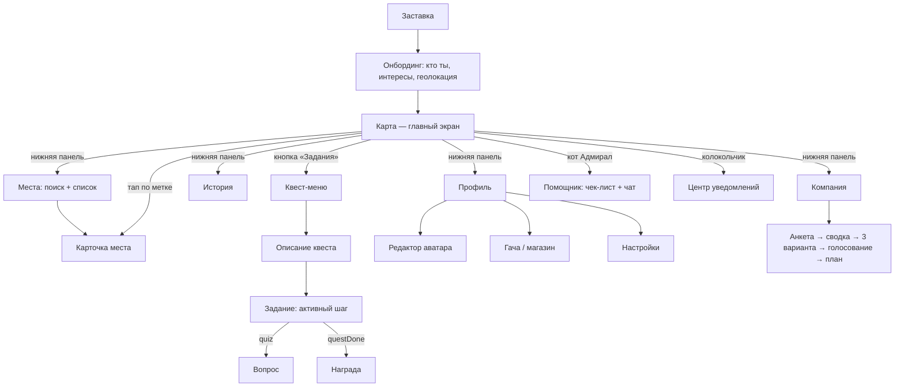

# Экраны приложения (фронт, React Native + Expo)

Планировка экранов для Димы: что на каждом экране, откуда берутся данные, что обязательно к демо.

**Главный принцип: карта всегда на фоне.** Почти всё открывается поверх неё — шторками снизу, всплывающими окнами и плашками. Полноэкранных экранов немного: онбординг, профиль, магазин, награда.

**Связанные документы:**
- карта и мост WebView — [map-engine.md](map-engine.md); контракт — `src/engine/protocol.ts` и `src/quests/types.ts`;
- подбор для компании — [match-group.md](match-group.md);
- палитра, шрифты, ассеты Макса — [brief-max.md](brief-max.md);
- режимы, демо и аватары — [design-doc.md](design-doc.md).

Пометки приоритета: **[MVP]** — нужно к демо, **[потом]** — после хакатона или если останется время.

## Навигация



**Нижняя панель (5 вкладок):** Карта · Компания · Места · История · Профиль. Помощник — не вкладка, а кот Адмирал в углу карты (см. диз-док, раздел 3).

## Общая раскладка

```
┌──────────────────────────────┐
│ ур.4 ▓▓▓░░  0,42 км²   🔔  ☁+8° │  ← верхняя плашка (HUD)
│ [Задания][Учёба][Досуг][История]│  ← чипы режимов карты
│                              │
│            КАРТА             │  ← WebView, всегда на фоне
│              ▲               │
│                         [2D] │  ← правый край: 2D/3D, «где я», слои
│ 🐱                      [◎]  │  ← Адмирал (помощник)
│ ┌──────────────────────────┐ │
│ │  шторка: задание / место │ │  ← нижняя шторка, 3 положения
│ └──────────────────────────┘ │
│ Карта Компания Места Ист. Проф │  ← нижняя панель
└──────────────────────────────┘
```

**Нижняя шторка (bottom sheet)** — главный контейнер. У неё три положения:
- свёрнута — одна строка;
- половина экрана — карточка;
- почти весь экран — список или подробности.

Шторка одна, её содержимое зависит от контекста: активный шаг, карточка места, результаты поиска.

## Экраны

### 1. Заставка и онбординг [MVP]

1. **Заставка:** логотип, туман расходится, кнопка «Войти в туман».
2. **«Кто ты?»:** 4 карточки с иллюстрациями Макса — первокурсник, новый житель, турист, местный.
3. **Интересы:** чипы `INTERESTS` из `src/match/matchGroup.ts` (море, смотровые, настолки, кино…). Шаг можно пропустить.
4. **Геолокация:** объясняем зачем («Туман рассеивается там, где ты идёшь. Данные остаются в телефоне»). Если отказ — режим симуляции, а не тупик.
5. **Первая реплика Адмирала** над картой и первая метка задания.

Данные: выбор и интересы сохраняются локально и подставляются в анкету «Компании».

### 2. Карта — главный экран [MVP]

- **Верх (HUD):** уровень и полоска опыта, «Открыто N км²» (событие `fogChanged`), колокольчик уведомлений, погода.
- **Чипы режимов:** Задания · Учёба · Досуг · История · События. Чип фильтрует метки: отправляет `showPlaces` с нужными местами.
- **Правый край:** 2D/3D (`setViewMode`), «где я» (`follow { on: true }`).
- **Тапы:**
  - по метке места — `placeTap` → карточка места;
  - по цели квеста — `questTargetTap` → подсказка шага;
  - долгое нажатие — `mapLongPress` → «Проложить маршрут сюда?» (`route`).
- **Адмирал** в левом нижнем углу: тап открывает помощника, бейдж показывает прогресс чек-листа.

Мост: при `ready` отправить `setPlayerMode: external`, дальше слать `gpsFix` из `expo-location`.

### 3. Выбор режима [MVP]

Две вещи, их нельзя путать:
- **Режим приложения** — вкладки нижней панели (Компания, Места, История…).
- **Слой карты** — чипы сверху на карте. Какие метки видны: задания, места для учёбы, досуг, история, события.

При переходе во вкладку слой карты переключается сам: «Места» → чип «Учёба», «История» → чип «История».

### 4. Поиск + список (шторка) [MVP]

- **Сверху:** поле поиска по названию и адресу. Под ним быстрые фильтры-чипы: **Бесплатно · До 300 ₽ · Открыто сейчас · Wi-Fi · Розетки · Тихо · Рядом · Без подъёма**.
- **Цель:** «учиться / творить / встретиться» — меняет набор фильтров.
- **Список:** карточка-строка с фото, названием, ценой («бесплатно» крупно и зелёным), расстоянием, «открыто ещё 2 ч». Значок «✓ проверено» или «не проверено».
- **Переключатель «список / карта».** В режиме карты список сворачивается, метки отфильтрованы.
- **Пусто:** «Ничего не нашли. Убрать фильтр «Тихо»?» — предложить ослабить самый строгий фильтр.

Данные:
- места — `data/places.json` (тип `Place`);
- «открыто сейчас» — `openMinutes()` из `src/match/hours.ts`;
- «рядом» — по `playerMoved`;
- «без подъёма» — команда `route` → поле `climb`.

### 5. Карточка места (шторка) [MVP]

```
┌──────────────────────────────┐
│ [фото]  Библиотека им. Горького│
│ учёба · культура    БЕСПЛАТНО │
│ открыто до 19:00 (ещё 2 ч)     │
│ 🤫 тихо  📶 Wi-Fi  🔌 розетки   │
│ 8 мин · ↑35 м  ▁▂▄▆▅▃ профиль │
│ [Маршрут] [Я здесь] [Ошибка?]  │
│ источник · проверено 13.11     │
└──────────────────────────────┘
```

- **«Маршрут»:** `route { to }` → ответ `{ distance, climb, descent, minutes, profile }`. Показать «8 мин, +35 м» и мини-профиль высот.
- **«Я здесь»:** чекин. Если идёт квест с шагом `visit`, шаг засчитается сам.
- **«Ошибка?»:** форма «Сообщить об ошибке».
- **Внизу:** ссылка на `source` и пометка «© участники OpenStreetMap», если место из OSM (лицензия ODbL).

### 6. Квест-меню (журнал заданий) [MVP]

- **Вкладки:** Доступные · Активное · Пройденные.
- **Карточка квеста:** портрет персонажа (ассеты Макса), название, заказчик, награда (монеты, уважение), число шагов, расстояние до старта.
- **Описание квеста:** `intro`, точка старта на карте (`flyTo`), кнопка **«Начать»** → `startQuestById`.
- **Пусто:** «Подойди к жёлтой метке или открой новый район — там появятся задания».

Данные: `listQuests` → `QuestSummary[]`. Активный квест — `getQuestState` или последнее событие `activeStep`.

### 7. Задание — активный шаг (шторка поверх карты) [MVP]

```
┌──────────────────────────────┐
│ «Золотой туман» · шаг 2 из 5  │
│ Дойди до фуникулёра           │
│ 340 м ───────▶  ▓▓▓▓░░ 60%    │
│ Дядя Гоша: Не отставай, туман │
│ сгущается…                    │
│ [Сдаться]          [На карте] │
└──────────────────────────────┘
```

- **Всегда:** название квеста, «шаг N из M», текст шага (`step.text`), расстояние (`distanceMeters`), прогресс (`progress`: секунды, предметы, ячейки, метры).
- **Реплики персонажа** — субтитры из `step.say`. Формат «Имя: текст», имя янтарным.
- **Свой интерфейс для типа шага (`step.type`):**

| Тип | Что показать | Действие игрока |
| --- | --- | --- |
| `goto` | расстояние до точки, таймер, если есть `timeLimit` | дойти |
| `hold` | круговой таймер «стой N секунд» | стоять в зоне |
| `tail` | расстояние до NPC, предупреждение «отстаёшь / слишком близко» | идти следом |
| `collect` | счётчик «собрано 2 из 4» | обойти точки |
| `explore` | «открой ещё N ячеек тумана» | гулять в тумане |
| `listen` | аудиоплеер с портретом рассказчика, включается в радиусе | дослушать → `completeListen` |
| `quiz` | всплывающее окно: вопрос и 3 ответа | выбрать → `answerQuiz { answer }` |
| `look` | подсказка «найди на фасаде…» | «Нашёл» → `confirmLook` |
| `visit` | место из каталога, ссылка на карточку | прийти, чекин засчитывается сам |

- **События:**
  - `stepDone` — короткая плашка «Шаг выполнен» и следующий шаг;
  - `questDone` — экран награды;
  - `questFailed` — окно «Задание провалено: {reason}» с кнопкой «Попробовать снова»;
  - `questStopped` — шторка закрывается.

### 8. Награда [MVP]

Полный экран, главный «вау»-момент демо (диз-док, раздел 9):
1. Экран затемняется, туман расходится.
2. Выплывает и поворачивается 3D-фигурка или карточка награды. Для MVP хватит картинки с анимацией, 3D — потом.
3. Монеты и уважение (`reward.cash`, `reward.rep`) считаются вверх.
4. Если выпала косметика — превью на аватаре.
5. Кнопки «В коллекцию» и «Дальше».

### 9. Профиль + награды [MVP]

- **Шапка:** аватар (слои), звание, полоска опыта, рамка профиля.
- **«Город открыт на N %»** и мини-карта с туманом, районы с процентами.
- **Коллекция:** полка с фигурками. Открытые — цветные, закрытые — серые силуэты с подсказкой «где-то у воды».
- **Бейджи:** «Картограф», «Покоритель сопок», «Вместе»…
- **Кнопки:** Редактор аватара · Магазин · Настройки · «Поделиться» (картинка «мой Владивосток» для сторис).

### 10. Редактор аватара [потом; для MVP — выбор из 3–4 готовых]

Слои по диз-доку (раздел 8.5): тело, голова, верх, низ, аксессуар, рамка. Сетка предметов из инвентаря, превью сверху. Косметика не даёт игровых преимуществ. Готовый аватар передаётся карте командой `setSelfAvatar` — она есть в плане, в мосте её пока нет.

### 11. Гача — внутриигровой магазин [потом, если останется время]

**Важно:** только за игровые монеты, которые даются за квесты. Никаких реальных денег. Лутбоксы за деньги — юридический риск, особенно когда в аудитории есть несовершеннолетние, и плохо смотрятся на социальном хакатоне.

- **Баннеры наборов:** «Портовый», «Туманный», «Сопки» — косметика для аватара, рамки, стили тумана и стрелки.
- **Кнопки:** «Крутить ×1» и «×10», цена в монетах.
- **Анимация выпадения** с редкостью: обычный, редкий, легендарный.
- **Шансы выпадения показаны открыто** на экране баннера.
- **Гарантия:** легендарный предмет максимум за N круток, счётчик виден.
- **Дубликаты** превращаются в осколки, за осколки можно купить конкретный предмет. Альтернатива гаче — витрина с фиксированными ценами.

### 12. Компания [MVP]

Поток по диз-доку (раздел 5):
1. **Старт:** «Собрать компанию» → «Передать телефон по кругу» (MVP) или «Ссылка / QR» (нужен бэкенд). Затем выбор когда: сегодня вечером, завтра, выходные.
2. **Анкета участника** (форма, ~30 секунд): имя и эмодзи, интересы-чипы (до 5), бюджет (ползунок 0 → 3000+ ₽), свободное время «с … до …», район, «спокойно ↔ активно», «без крутых подъёмов».
3. **Сводка группы:** аватарки, общее окно времени, бюджетный потолок, общие интересы. Кнопка «Подобрать».
4. **Результат — 3 карточки** из `matchGroup()`: фото, название, цена на человека, дорога у каждого, строка «почему вам» (`reason`), флаги («цена неизвестна»). Если вариантов меньше трёх — подсказки из `hints`.
5. **Голосование** 👍/👎, победитель подсвечен.
6. **План:** маршрут на карте, время сбора, «Поделиться в чат» и «Сделать квестом».

### 13. История [MVP — один маршрут]

- **Список маршрутов.** Для MVP один — «Золотой туман», 6 точек.
- **Экран точки:** аудиоплеер с портретом рассказчика (шаг `listen`), слайдер «тогда / сейчас», 2–3 карточки фактов.
- **«Откуда это известно?»** под каждым фактом — источник. Значок «✓ проверено» или «легенда».

### 14. Помощник [MVP — чек-лист; чат потом]

- **Чек-лист «Первая неделя»** — набор зависит от выбора в онбординге. У пунктов кнопка «Показать на карте», выполненные зачёркиваются отпечатком лапы.
- **Чат «Спроси Адмирала»** с кнопками-подсказками: «Где позаниматься?», «Куда в дождь?». Ответ приходит с карточками мест из каталога. Отвечает только по базе; нужен прокси к ИИ, его ещё нет.

### 15. Уведомления [MVP — всплывающие; центр потом]

- **Всплывающие плашки (toast)** сверху, 3–4 секунды, по тапу ведут куда надо:
  - «Рядом новое задание»;
  - «Шаг выполнен»;
  - «+50 опыта»;
  - «Район Эгершельд открыт на 25 %»;
  - «Аня зовёт в компанию».
- **Центр уведомлений** (колокольчик): список с группами «Сегодня / Раньше», непрочитанные выделены.
- **Пуши (`expo-notifications`)** — потом: приглашения в группу, «рядом квест», напоминание о встрече.

### 16. Формы [MVP — анкета компании; остальное потом]

Общие компоненты для всех форм: поле, чипы, ползунок, выбор времени, выбор точки на карте, фото.

| Форма | Где | Приоритет |
| --- | --- | --- |
| Анкета участника | Компания | MVP |
| Сообщить об ошибке в месте | Карточка места | потом |
| Добавить место | Места | потом |
| Создать группу | Компания | потом |
| Оценка квеста 👍/👎 | после награды | потом |

### 17. Всплывающие окна (popup) [MVP]

- **Подтверждения:** «Сдаться и бросить квест?», «Сбросить прогресс?».
- **Разрешения:** геолокация, уведомления — с объяснением зачем, до системного окна.
- **Ошибки:** «Нет сети — карта работает офлайн в сохранённом радиусе», «Не удалось построить маршрут».
- **Вопрос квеста** (`quiz`) — тоже всплывающее окно.

### 18. Настройки [потом; в MVP — минимум]

- **Режим перемещения:** GPS или симуляция (для демо).
- **2D / 3D по умолчанию.**
- **Видимость для других:** `hidden` · `party` · `friends` · `public` (диз-док, 8.5).
- **Офлайн-карта:** сохранить район.
- **Сброс прогресса, о проекте, лицензии** (OSM, OpenFreeMap, Mapzen).

## Состояния, которые нужны везде

- **Загрузка:** скелетоны карточек, а не крутилка на весь экран.
- **Пусто:** понятная фраза и одно действие («ослабить фильтр», «открыть новый район»).
- **Ошибка:** что случилось и кнопка «Повторить».
- **Офлайн:** плашка сверху; карта работает в сохранённом радиусе.
- **Выключенная геолокация:** предложить симуляцию.

## Порядок работы для демо

Порядок повторяет сценарий демо из диз-дока, раздел 11:
1. Карта с мостом и шторкой.
2. Онбординг.
3. Квест-меню, активный шаг и награда.
4. Места: поиск и карточка.
5. Компания.
6. Профиль.
7. История: один маршрут.
8. Уведомления-плашки.

Гача, центр уведомлений, редактор аватара, чат и формы, кроме анкеты, — потом.
